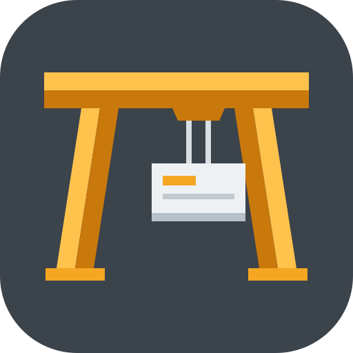
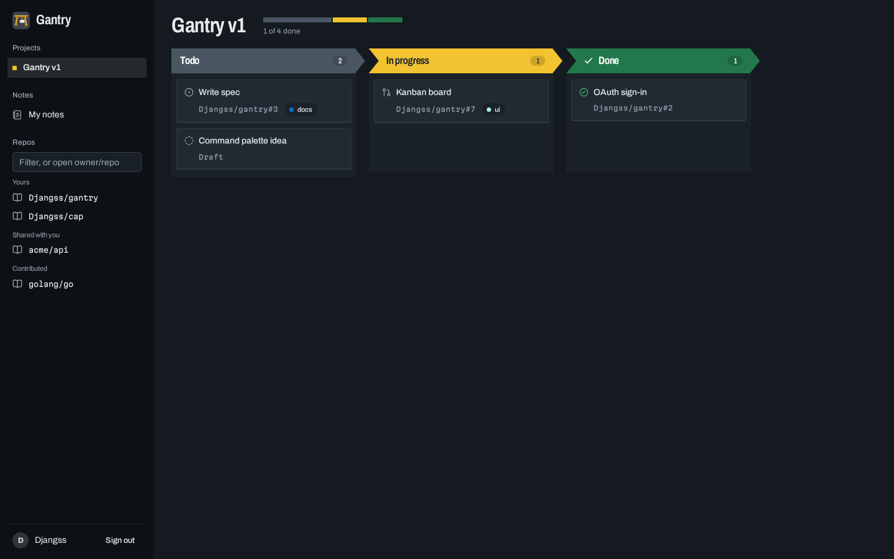
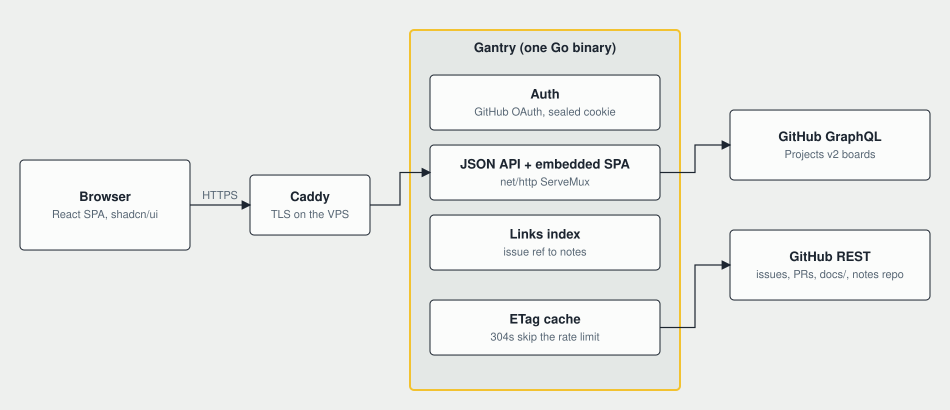

# Gantry

A gantry crane lifts cargo and moves it where it needs to go. Gantry does the same for your work. It's a personal hub that puts your GitHub Projects kanban, issues and pull requests, repo docs, Markdown notes and Excalidraw drawings in one place, all stored in GitHub.



## Features

- **Kanban on GitHub Projects v2.** Drag a card and its Status changes on GitHub.
- **Issue and PR drawer** with comments, reviews, checks and the notes linked to that issue.
- **Repo docs, edited in place.** Open any repo's `docs/` folder, edit Markdown with live preview, and each save is a commit.
- **Notes and drawings** in a private notes repo, linked to issues by `owner/repo#123`.
- **Live updates.** Gantry adds its own webhooks to your repos, so an issue edited on GitHub updates the open board and drawer without a reload.
- **Work is never lost silently.** Drafts survive a crash, and a save that conflicts with a change on GitHub asks you what to keep.

## Architecture



The diagram source is [`docs/architecture.drawio`](docs/architecture.drawio). Open it in draw.io; the SVG also opens there for editing.

- **One Go binary** serves the JSON API and the embedded React app. REST calls go through [go-github](https://github.com/google/go-github); Projects v2 boards use GraphQL.
- **The GitHub token never reaches the browser.** It lives in an AES-GCM encrypted, HttpOnly cookie, and only one GitHub login is allowed in.
- **No database.** GitHub is the store. Conditional requests (ETag and 304) keep pages fast and inside the API rate limit.
- **Frontend:** React, Vite, Tailwind CSS and shadcn/ui, TanStack Query, dnd-kit, CodeMirror and Excalidraw. The visual direction is in [`docs/design.md`](docs/design.md).

## Run locally

1. Create a GitHub OAuth App with the callback `http://localhost:8080/auth/callback`.
2. Build the web app, then start the server:

```bash
cd web && npm ci && npm run build && cd ..
export GITHUB_CLIENT_ID=... GITHUB_CLIENT_SECRET=... ALLOWED_LOGIN=<your-login> NOTES_REPO=<your-login>/notes \
  BASE_URL=http://localhost:8080 COOKIE_KEY=$(openssl rand -base64 32)
go run ./cmd/server
```

3. For frontend work, run `cd web && npm run dev` and open http://localhost:5173. Sign in once on port 8080 first; the cookie is shared across localhost ports.

## Tests

```bash
go test -race ./cmd/... ./internal/...
cd web && npm test && npx playwright test smoke
cd web && npx playwright test screens   # writes screenshots/ for every view, light and dark, desktop and phone
```

## Deploy

Push a `v*` tag to build and publish `ghcr.io/djangss/gantry`. On the server, put the environment variables above in `.env` next to `compose.yaml`, then run `docker compose up -d` behind your reverse proxy.

### Live updates (optional)

Set `WEBHOOK_SECRET` (any long random string, e.g. `openssl rand -hex 32`) in `.env`. That's all: when you open Gantry, it adds its webhook (`<BASE_URL>/webhooks/github`) to every repo you administer, at most once every 6 hours, and skips repos that already have it.

Repos you don't administer (contributed or watched) can't take a webhook; they refresh on reload. GitHub only sends Projects v2 item events for organization-owned projects, so card moves on personal boards show up on the next refresh while issue edits stay live. Without `WEBHOOK_SECRET`, the webhook endpoint returns 404 and nothing is registered.
