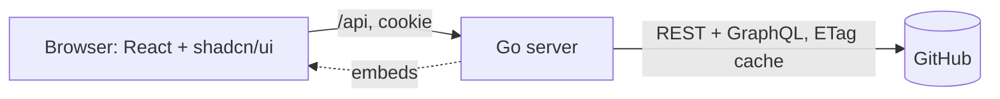

# Gantry v1 Implementation Plan

> **For agentic workers:** REQUIRED SUB-SKILL: Use superpowers:subagent-driven-development (recommended) or superpowers:executing-plans to implement this plan task-by-task. Steps use checkbox (`- [ ]`) syntax for tracking.

**Goal:** Build Gantry v1, a single-user web app on the Hetzner VPS. It shows GitHub Projects v2 boards as a kanban, opens issues and PRs in a drawer, edits repo `docs/` Markdown, and keeps Markdown notes and Excalidraw drawings in a private notes repo, linked to issues.

**Architecture:** One Go binary serves a JSON API and the embedded React SPA. The browser only talks to Gantry. Go holds the GitHub OAuth token in an encrypted cookie and calls GitHub REST and GraphQL directly with `net/http`. There is no database: GitHub is the store, and an ETag-aware HTTP transport makes refetches cheap.

**Tech Stack:** Go 1.27 (stdlib only: `net/http` ServeMux patterns, `crypto/aes` GCM, `log/slog`, `embed`). React + Vite + TypeScript, Tailwind CSS v4, shadcn/ui, TanStack Query, React Router, dnd-kit, CodeMirror 6 (`@uiw/react-codemirror`), react-markdown + remark-gfm, `@excalidraw/excalidraw`, sonner. Tests: `go test`, Vitest, Playwright.

**Spec:** `docs/superpowers/specs/2026-11-09-gantry-design.md`

## Global Constraints

- Go module path: `github.com/Djangss/gantry`. Go 1.27. **No third-party Go dependencies.**
- Node 26. The frontend lives in `web/`. The built SPA goes to `web/dist` and is embedded by `web/embed.go`.
- Never run `go vet ./...` or `go test ./...`: `web/node_modules` can contain stray `.go` files. Always use `./cmd/... ./internal/... ./web`.
- Env vars (exact names): `GITHUB_CLIENT_ID`, `GITHUB_CLIENT_SECRET`, `COOKIE_KEY` (32 bytes, base64), `ALLOWED_LOGIN`, `NOTES_REPO` (`owner/repo`), `BASE_URL`, `PORT` (default `8080`).
- Cookies: `gantry_session` (encrypted session) and `gantry_state` (OAuth state). Both are `HttpOnly`, `SameSite=Lax`, and `Secure` when `BASE_URL` is https.
- CSRF header: every non-GET request sends `X-Requested-With: gantry`. The server rejects a missing header with 403.
- OAuth scopes: `repo project`.
- API error body: `{"error": string, "code": string, "reset"?: RFC3339}`. Codes: `unauthorized`, `forbidden`, `not_found`, `conflict`, `rate_limited`, `bad_request`, `upstream`.
- Note files live at `notes/<slug>.md`, with frontmatter `title:` and `links:`. Drawings live at `drawings/<slug>.excalidraw`, with a top-level `"links"` array. Link refs use the form `owner/repo#number` and are matched case-insensitively.
- Commit messages: Conventional Commits (`feat:`, `fix:`, `test:`, `docs:`, `chore:`, `ci:`). **No AI co-author or "generated by" lines.**
- Production: `https://gantry.mijotez.me`, served behind the Caddy container on Docker network `norish_default`.
- UI: shadcn/ui components and Tailwind only. No hand-written CSS files apart from the `src/index.css` theme. Accessibility work is out of scope for v1 (owner decision). Keep the semantic roles the tests use.

## Review Focus

1. **Link refs that differ in case** (`djangss/Cap#3` vs `Djangss/cap#3`) must still match the issue. Pinned by Task 7 `TestLookupCaseInsensitive`.
2. **A corrupt or non-JSON `.excalidraw` file** must not open as an empty canvas, because saving would overwrite it. Pinned by Task 13 `parseDrawing` tests and the editor's refusal branch.
3. **Typing while a save is in flight** must not be discarded when the save returns. Pinned by Task 12 `afterSave` test.
4. **Creating a note whose slug already exists** must not overwrite the existing file. Pinned by Task 4 `TestPutContentsCreateExistingIsConflict` and Task 12 `saveFile` 409 test.
5. **A GitHub login that differs from `ALLOWED_LOGIN` only in case** must be allowed, and any other login rejected. Pinned by Task 2 `TestCallbackAllowedCaseInsensitive` and `TestCallbackRejectsOtherLogin`.

---

## File Structure

```
go.mod
cmd/server/main.go            config from env, slog, ListenAndServe
cmd/server/main_test.go
internal/auth/auth.go         OAuth flow, sealed cookie session, Require, CSRF
internal/auth/auth_test.go
internal/gh/client.go         do(), Error, errorFrom
internal/gh/etag.go           ETag-caching RoundTripper
internal/gh/etag_test.go
internal/gh/repos.go          Repos, Issue, CreateComment, Tree, GetContents, PutContents
internal/gh/repos_test.go
internal/gh/projects.go       graphql(), Projects, Board, MoveItem
internal/gh/projects_test.go
internal/notes/parse.go       ParseNote, ParseDrawing
internal/notes/parse_test.go
internal/notes/index.go       links Index
internal/notes/index_test.go
internal/api/server.go        Config, NewServer, routes
internal/api/spa.go           SPA file server with index.html fallback
internal/api/handlers.go      endpoint handlers
internal/api/errors.go        writeJSON, badRequest, fail
internal/api/server_test.go
web/embed.go                  //go:embed all:dist
web/package.json, vite.config.ts, tsconfig.json, index.html, components.json
web/src/main.tsx, App.tsx, index.css
web/src/api.ts, types.ts
web/src/lib/{utils,me,ref,board,frontmatter,drafts,files,drawing,useEditableFile}.ts
web/src/components/ui/*       generated by shadcn CLI
web/src/components/{Layout,Login,Home,ErrorBoundary,BoardView,ItemDrawer,FilesView,FileBar,MarkdownEditor,DrawingEditor}.tsx
web/e2e/{mocks,smoke.spec,screens.spec}.ts, web/playwright.config.ts
docs/design.md                design direction (Task 9)
Dockerfile, .dockerignore, compose.yaml, .gitignore
.github/workflows/{ci,release}.yml
README.md
```

---

### Task 0: GitHub repo, issue, branch (ask the owner before running)

These steps publish to GitHub, so get an explicit yes first.

- [ ] **Step 1: Create the public repo and push main**

```bash
cd ~/gantry
gh repo create Djangss/gantry --public --source . --push --description "Personal project hub: GitHub Projects kanban, docs, notes and Excalidraw drawings in one app"
```

- [ ] **Step 2: Create the v1 issue and branch**

```bash
gh issue create --title "Gantry v1" --body "Implements docs/superpowers/specs/2026-11-09-gantry-design.md via docs/superpowers/plans/2026-11-09-gantry-v1.md.

Acceptance: the 6 success criteria in spec section 1."
git switch -c 1-gantry-v1   # use the issue number gh printed
```

- [ ] **Step 3: Create the private notes repo**

```bash
gh repo create Djangss/notes --private --add-readme --description "Gantry notes and drawings"
```

---

### Task 1: Go scaffold, config, healthz, SPA serving

**Files:**
- Create: `go.mod`, `.gitignore`, `cmd/server/main.go`, `cmd/server/main_test.go`, `internal/api/server.go`, `internal/api/spa.go`, `internal/api/server_test.go`, `web/embed.go`

**Interfaces:**
- Produces: `api.Config` (fields below), `api.NewServer(cfg api.Config, spa fs.FS) (http.Handler, error)`, `spaHandler(dist fs.FS) http.Handler`, `web.Dist() fs.FS`, `loadConfig(getenv func(string) string) (api.Config, error)`.

- [ ] **Step 1: Init module, ignore file, placeholder dist**

```bash
cd ~/gantry
go mod init github.com/Djangss/gantry
mkdir -p cmd/server internal/api web/dist
echo '<!doctype html><title>Gantry</title>' > web/dist/index.html
cat > .gitignore <<'EOF'
.env
web/node_modules/
web/dist/
web/test-results/
web/playwright-report/
web/screenshots/
EOF
```

- [ ] **Step 2: Write the failing tests**

`cmd/server/main_test.go`:

```go
package main

import (
	"encoding/base64"
	"strings"
	"testing"
)

func valid() map[string]string {
	return map[string]string{
		"GITHUB_CLIENT_ID":     "id",
		"GITHUB_CLIENT_SECRET": "secret",
		"COOKIE_KEY":           base64.StdEncoding.EncodeToString(make([]byte, 32)),
		"ALLOWED_LOGIN":        "Djangss",
		"NOTES_REPO":           "Djangss/notes",
		"BASE_URL":             "https://gantry.mijotez.me/",
	}
}

func env(m map[string]string) func(string) string { return func(k string) string { return m[k] } }

func TestLoadConfigValid(t *testing.T) {
	cfg, err := loadConfig(env(valid()))
	if err != nil {
		t.Fatal(err)
	}
	if cfg.Port != "8080" || cfg.BaseURL != "https://gantry.mijotez.me" || len(cfg.CookieKey) != 32 {
		t.Fatalf("bad config: %+v", cfg)
	}
	if cfg.GitHubAPIURL != "https://api.github.com" || cfg.GitHubWebURL != "https://github.com" {
		t.Fatalf("bad GitHub URLs: %+v", cfg)
	}
}

func TestLoadConfigMissing(t *testing.T) {
	m := valid()
	delete(m, "GITHUB_CLIENT_SECRET")
	delete(m, "BASE_URL")
	_, err := loadConfig(env(m))
	if err == nil || !strings.Contains(err.Error(), "GITHUB_CLIENT_SECRET") || !strings.Contains(err.Error(), "BASE_URL") {
		t.Fatalf("want both missing vars named, got %v", err)
	}
}

func TestLoadConfigBadKey(t *testing.T) {
	m := valid()
	m["COOKIE_KEY"] = "c2hvcnQ="
	if _, err := loadConfig(env(m)); err == nil {
		t.Fatal("want error for short key")
	}
}

func TestLoadConfigBadNotesRepo(t *testing.T) {
	m := valid()
	m["NOTES_REPO"] = "notes"
	if _, err := loadConfig(env(m)); err == nil {
		t.Fatal("want error for NOTES_REPO without owner")
	}
}
```

`internal/api/server_test.go`:

```go
package api

import (
	"net/http/httptest"
	"testing"
	"testing/fstest"
)

func TestHealthzAndSPA(t *testing.T) {
	spa := fstest.MapFS{
		"index.html":    {Data: []byte("<html>app</html>")},
		"assets/app.js": {Data: []byte("js")},
	}
	h, err := NewServer(Config{}, spa)
	if err != nil {
		t.Fatal(err)
	}
	for path, want := range map[string]string{
		"/healthz":       "ok",
		"/assets/app.js": "js",
		"/projects/abc":  "<html>app</html>",
	} {
		w := httptest.NewRecorder()
		h.ServeHTTP(w, httptest.NewRequest("GET", path, nil))
		if w.Code != 200 || w.Body.String() != want {
			t.Errorf("%s: got %d %q, want %q", path, w.Code, w.Body.String(), want)
		}
	}
}
```

- [ ] **Step 3: Run tests to verify they fail**

Run: `go test ./cmd/... ./internal/...`
Expected: FAIL to compile, with `undefined: loadConfig` / `undefined: NewServer`.

- [ ] **Step 4: Implement**

`web/embed.go`:

```go
// Package web embeds the built SPA. Run `npm run build` in web/ before `go build`.
package web

import (
	"embed"
	"io/fs"
)

//go:embed all:dist
var dist embed.FS

func Dist() fs.FS {
	sub, err := fs.Sub(dist, "dist")
	if err != nil {
		panic(err)
	}
	return sub
}
```

`internal/api/spa.go`:

```go
package api

import (
	"io/fs"
	"net/http"
	"path"
	"strings"
)

// spaHandler serves built assets and falls back to index.html for client routes.
func spaHandler(dist fs.FS) http.Handler {
	files := http.FileServerFS(dist)
	return http.HandlerFunc(func(w http.ResponseWriter, r *http.Request) {
		p := strings.TrimPrefix(path.Clean(r.URL.Path), "/")
		if p != "" {
			if _, err := fs.Stat(dist, p); err != nil {
				http.ServeFileFS(w, r, dist, "index.html")
				return
			}
		}
		files.ServeHTTP(w, r)
	})
}
```

`internal/api/server.go` (Task 6 replaces this file):

```go
package api

import (
	"io/fs"
	"net/http"
)

type Config struct {
	ClientID, ClientSecret     string
	CookieKey                  []byte
	AllowedLogin               string
	NotesRepo                  string // owner/repo
	BaseURL                    string
	Port                       string
	GitHubWebURL, GitHubAPIURL string
}

func NewServer(cfg Config, spa fs.FS) (http.Handler, error) {
	mux := http.NewServeMux()
	mux.HandleFunc("GET /healthz", func(w http.ResponseWriter, r *http.Request) { w.Write([]byte("ok")) })
	mux.Handle("/", spaHandler(spa))
	return mux, nil
}
```

`cmd/server/main.go`:

```go
package main

import (
	"encoding/base64"
	"errors"
	"fmt"
	"log/slog"
	"net/http"
	"os"
	"strings"

	"github.com/Djangss/gantry/internal/api"
	"github.com/Djangss/gantry/web"
)

func main() {
	slog.SetDefault(slog.New(slog.NewJSONHandler(os.Stdout, nil)))
	cfg, err := loadConfig(os.Getenv)
	if err != nil {
		slog.Error("config", "err", err)
		os.Exit(1)
	}
	h, err := api.NewServer(cfg, web.Dist())
	if err != nil {
		slog.Error("startup", "err", err)
		os.Exit(1)
	}
	slog.Info("listening", "port", cfg.Port)
	if err := http.ListenAndServe(":"+cfg.Port, h); err != nil {
		slog.Error("server", "err", err)
		os.Exit(1)
	}
}

func loadConfig(getenv func(string) string) (api.Config, error) {
	var missing []string
	need := func(k string) string {
		v := getenv(k)
		if v == "" {
			missing = append(missing, k)
		}
		return v
	}
	cfg := api.Config{
		ClientID:     need("GITHUB_CLIENT_ID"),
		ClientSecret: need("GITHUB_CLIENT_SECRET"),
		AllowedLogin: need("ALLOWED_LOGIN"),
		NotesRepo:    need("NOTES_REPO"),
		BaseURL:      strings.TrimRight(need("BASE_URL"), "/"),
		Port:         getenv("PORT"),
		GitHubWebURL: "https://github.com",
		GitHubAPIURL: "https://api.github.com",
	}
	key := need("COOKIE_KEY")
	if len(missing) > 0 {
		return cfg, fmt.Errorf("missing env: %s", strings.Join(missing, ", "))
	}
	if cfg.Port == "" {
		cfg.Port = "8080"
	}
	k, err := base64.StdEncoding.DecodeString(key)
	if err != nil || len(k) != 32 {
		return cfg, errors.New("COOKIE_KEY must be 32 bytes, base64 (openssl rand -base64 32)")
	}
	cfg.CookieKey = k
	owner, repo, ok := strings.Cut(cfg.NotesRepo, "/")
	if !ok || owner == "" || repo == "" || strings.Contains(repo, "/") {
		return cfg, errors.New("NOTES_REPO must be owner/repo")
	}
	return cfg, nil
}
```

- [ ] **Step 5: Run tests to verify they pass**

Run: `go test ./cmd/... ./internal/... && go vet ./cmd/... ./internal/... ./web`
Expected: PASS, with no vet output.

- [ ] **Step 6: Commit**

```bash
git add go.mod .gitignore cmd internal web/embed.go
git commit -m "feat: scaffold Go server with config, healthz and SPA serving"
```

---

### Task 2: Auth — OAuth flow, sealed cookie session, allowlist, CSRF

**Files:**
- Create: `internal/auth/auth.go`, `internal/auth/auth_test.go`

**Interfaces:**
- Produces:
  - `type Session struct{ Token, Login string }`
  - `type Options struct{ ClientID, ClientSecret, AllowedLogin, BaseURL, WebURL, APIURL string; Key []byte }`
  - `auth.New(Options) (*Auth, error)`
  - methods `Login`, `Callback`, `Logout` (all `http.HandlerFunc` shape), `Require(http.Handler) http.Handler`, `SetSession(w, Session) error`, `ClearSession(w)`
  - `auth.FromContext(ctx) (Session, bool)`
  - `auth.CSRF(http.Handler) http.Handler`

- [ ] **Step 1: Write the failing tests**

`internal/auth/auth_test.go`:

```go
package auth

import (
	"fmt"
	"net/http"
	"net/http/httptest"
	"net/url"
	"strings"
	"testing"
)

func fakeGitHub(t *testing.T, login string) *httptest.Server {
	mux := http.NewServeMux()
	mux.HandleFunc("POST /login/oauth/access_token", func(w http.ResponseWriter, r *http.Request) {
		r.ParseForm()
		w.Header().Set("Content-Type", "application/json")
		if r.Form.Get("code") != "good-code" || r.Form.Get("client_secret") != "secret" {
			fmt.Fprint(w, `{"error":"bad_verification_code"}`)
			return
		}
		fmt.Fprint(w, `{"access_token":"tok-123"}`)
	})
	mux.HandleFunc("GET /user", func(w http.ResponseWriter, r *http.Request) {
		if r.Header.Get("Authorization") != "Bearer tok-123" {
			w.WriteHeader(401)
			return
		}
		fmt.Fprintf(w, `{"login":%q}`, login)
	})
	srv := httptest.NewServer(mux)
	t.Cleanup(srv.Close)
	return srv
}

func newAuth(t *testing.T, gh *httptest.Server) *Auth {
	a, err := New(Options{ClientID: "id", ClientSecret: "secret", AllowedLogin: "Djangss",
		BaseURL: "https://gantry.test", WebURL: gh.URL, APIURL: gh.URL, Key: make([]byte, 32)})
	if err != nil {
		t.Fatal(err)
	}
	return a
}

func callback(a *Auth, code, state, cookieState string) *httptest.ResponseRecorder {
	r := httptest.NewRequest("GET", "/auth/callback?code="+code+"&state="+state, nil)
	r.AddCookie(&http.Cookie{Name: stateCookie, Value: cookieState})
	w := httptest.NewRecorder()
	a.Callback(w, r)
	return w
}

func session(w *httptest.ResponseRecorder) *http.Cookie {
	for _, c := range w.Result().Cookies() {
		if c.Name == sessionCookie && c.MaxAge > 0 {
			return c
		}
	}
	return nil
}

func TestLoginRedirect(t *testing.T) {
	gh := fakeGitHub(t, "Djangss")
	w := httptest.NewRecorder()
	newAuth(t, gh).Login(w, httptest.NewRequest("GET", "/auth/login", nil))
	if w.Code != http.StatusFound {
		t.Fatalf("code %d", w.Code)
	}
	loc, _ := url.Parse(w.Header().Get("Location"))
	if !strings.HasPrefix(loc.String(), gh.URL+"/login/oauth/authorize?") {
		t.Fatalf("location %s", loc)
	}
	q := loc.Query()
	if q.Get("scope") != "repo project" || q.Get("redirect_uri") != "https://gantry.test/auth/callback" {
		t.Fatalf("query %v", q)
	}
	var state string
	for _, c := range w.Result().Cookies() {
		if c.Name == stateCookie {
			state = c.Value
		}
	}
	if state == "" || state != q.Get("state") {
		t.Fatalf("state cookie %q vs param %q", state, q.Get("state"))
	}
}

func TestCallbackAllowedCaseInsensitive(t *testing.T) {
	w := callback(newAuth(t, fakeGitHub(t, "djangss")), "good-code", "s1", "s1")
	if w.Code != http.StatusFound || w.Header().Get("Location") != "/" {
		t.Fatalf("got %d %s", w.Code, w.Header().Get("Location"))
	}
	c := session(w)
	if c == nil || !c.HttpOnly || !c.Secure || c.SameSite != http.SameSiteLaxMode {
		t.Fatalf("bad session cookie %+v", c)
	}
}

func TestCallbackRejectsOtherLogin(t *testing.T) {
	w := callback(newAuth(t, fakeGitHub(t, "mallory")), "good-code", "s1", "s1")
	if w.Code != http.StatusForbidden || session(w) != nil {
		t.Fatalf("got %d, cookie %v", w.Code, session(w))
	}
}

func TestCallbackBadState(t *testing.T) {
	w := callback(newAuth(t, fakeGitHub(t, "Djangss")), "good-code", "s1", "other")
	if w.Code != http.StatusBadRequest {
		t.Fatalf("got %d", w.Code)
	}
}

func TestCallbackBadCode(t *testing.T) {
	w := callback(newAuth(t, fakeGitHub(t, "Djangss")), "bad-code", "s1", "s1")
	if w.Code != http.StatusBadGateway {
		t.Fatalf("got %d", w.Code)
	}
}

func TestRequire(t *testing.T) {
	a := newAuth(t, fakeGitHub(t, "Djangss"))
	var seen Session
	h := a.Require(http.HandlerFunc(func(w http.ResponseWriter, r *http.Request) { seen, _ = FromContext(r.Context()) }))

	w := httptest.NewRecorder()
	h.ServeHTTP(w, httptest.NewRequest("GET", "/api/me", nil))
	if w.Code != 401 || !strings.Contains(w.Body.String(), `"code":"unauthorized"`) {
		t.Fatalf("no cookie: %d %s", w.Code, w.Body)
	}

	r := httptest.NewRequest("GET", "/api/me", nil)
	r.AddCookie(&http.Cookie{Name: sessionCookie, Value: "tampered"})
	w = httptest.NewRecorder()
	h.ServeHTTP(w, r)
	if w.Code != 401 {
		t.Fatalf("tampered: %d", w.Code)
	}

	set := httptest.NewRecorder()
	if err := a.SetSession(set, Session{Token: "tok", Login: "Djangss"}); err != nil {
		t.Fatal(err)
	}
	r = httptest.NewRequest("GET", "/api/me", nil)
	r.AddCookie(set.Result().Cookies()[0])
	w = httptest.NewRecorder()
	h.ServeHTTP(w, r)
	if w.Code != 200 || seen.Token != "tok" {
		t.Fatalf("valid: %d %+v", w.Code, seen)
	}
}

func TestCSRF(t *testing.T) {
	h := CSRF(http.HandlerFunc(func(w http.ResponseWriter, r *http.Request) {}))
	cases := []struct {
		method, header string
		want           int
	}{{"POST", "", 403}, {"PUT", "other", 403}, {"POST", "gantry", 200}, {"GET", "", 200}}
	for _, c := range cases {
		r := httptest.NewRequest(c.method, "/api/x", nil)
		if c.header != "" {
			r.Header.Set("X-Requested-With", c.header)
		}
		w := httptest.NewRecorder()
		h.ServeHTTP(w, r)
		if w.Code != c.want {
			t.Errorf("%s header=%q: got %d want %d", c.method, c.header, w.Code, c.want)
		}
	}
}
```

- [ ] **Step 2: Run tests to verify they fail**

Run: `go test ./internal/auth/`
Expected: FAIL to compile (`undefined: New`).

- [ ] **Step 3: Implement**

`internal/auth/auth.go`:

```go
// Package auth handles GitHub OAuth sign-in and the encrypted session cookie.
package auth

import (
	"context"
	"crypto/aes"
	"crypto/cipher"
	"crypto/rand"
	"encoding/base64"
	"encoding/hex"
	"encoding/json"
	"errors"
	"fmt"
	"log/slog"
	"net/http"
	"net/url"
	"strings"
	"time"
)

type Session struct {
	Token string `json:"t"`
	Login string `json:"l"`
}

type Options struct {
	ClientID, ClientSecret string
	AllowedLogin           string
	BaseURL                string // public URL of Gantry, e.g. https://gantry.mijotez.me
	WebURL                 string // https://github.com
	APIURL                 string // https://api.github.com
	Key                    []byte // 32 bytes
}

type Auth struct {
	opt  Options
	aead cipher.AEAD
	http *http.Client
}

const (
	sessionCookie = "gantry_session"
	stateCookie   = "gantry_state"
)

type ctxKey struct{}

func New(opt Options) (*Auth, error) {
	block, err := aes.NewCipher(opt.Key)
	if err != nil {
		return nil, fmt.Errorf("cookie key: %w", err)
	}
	aead, err := cipher.NewGCM(block)
	if err != nil {
		return nil, err
	}
	return &Auth{opt: opt, aead: aead, http: &http.Client{Timeout: 15 * time.Second}}, nil
}

func FromContext(ctx context.Context) (Session, bool) {
	s, ok := ctx.Value(ctxKey{}).(Session)
	return s, ok
}

func (a *Auth) secure() bool { return strings.HasPrefix(a.opt.BaseURL, "https://") }

func (a *Auth) seal(s Session) (string, error) {
	b, err := json.Marshal(s)
	if err != nil {
		return "", err
	}
	nonce := make([]byte, a.aead.NonceSize())
	if _, err := rand.Read(nonce); err != nil {
		return "", err
	}
	return base64.RawURLEncoding.EncodeToString(a.aead.Seal(nonce, nonce, b, nil)), nil
}

func (a *Auth) open(v string) (Session, error) {
	var s Session
	b, err := base64.RawURLEncoding.DecodeString(v)
	n := a.aead.NonceSize()
	if err != nil || len(b) < n {
		return s, errors.New("bad session")
	}
	plain, err := a.aead.Open(nil, b[:n], b[n:], nil)
	if err != nil {
		return s, errors.New("bad session")
	}
	return s, json.Unmarshal(plain, &s)
}

func (a *Auth) SetSession(w http.ResponseWriter, s Session) error {
	v, err := a.seal(s)
	if err != nil {
		return err
	}
	http.SetCookie(w, &http.Cookie{Name: sessionCookie, Value: v, Path: "/", MaxAge: 30 * 24 * 3600,
		HttpOnly: true, Secure: a.secure(), SameSite: http.SameSiteLaxMode})
	return nil
}

func (a *Auth) ClearSession(w http.ResponseWriter) {
	http.SetCookie(w, &http.Cookie{Name: sessionCookie, Path: "/", MaxAge: -1,
		HttpOnly: true, Secure: a.secure(), SameSite: http.SameSiteLaxMode})
}

func (a *Auth) Login(w http.ResponseWriter, r *http.Request) {
	b := make([]byte, 16)
	if _, err := rand.Read(b); err != nil {
		http.Error(w, "rng failure", http.StatusInternalServerError)
		return
	}
	state := hex.EncodeToString(b)
	http.SetCookie(w, &http.Cookie{Name: stateCookie, Value: state, Path: "/auth", MaxAge: 600,
		HttpOnly: true, Secure: a.secure(), SameSite: http.SameSiteLaxMode})
	q := url.Values{
		"client_id":    {a.opt.ClientID},
		"redirect_uri": {a.opt.BaseURL + "/auth/callback"},
		"scope":        {"repo project"},
		"state":        {state},
	}
	http.Redirect(w, r, a.opt.WebURL+"/login/oauth/authorize?"+q.Encode(), http.StatusFound)
}

func (a *Auth) Callback(w http.ResponseWriter, r *http.Request) {
	c, err := r.Cookie(stateCookie)
	if err != nil || c.Value == "" || c.Value != r.URL.Query().Get("state") {
		http.Error(w, "invalid OAuth state, try signing in again", http.StatusBadRequest)
		return
	}
	http.SetCookie(w, &http.Cookie{Name: stateCookie, Path: "/auth", MaxAge: -1})
	token, err := a.exchange(r.Context(), r.URL.Query().Get("code"))
	if err != nil {
		slog.Warn("oauth exchange", "err", err)
		http.Error(w, "GitHub sign-in failed", http.StatusBadGateway)
		return
	}
	login, err := a.user(r.Context(), token)
	if err != nil {
		slog.Warn("oauth user", "err", err)
		http.Error(w, "GitHub sign-in failed", http.StatusBadGateway)
		return
	}
	if !strings.EqualFold(login, a.opt.AllowedLogin) {
		slog.Warn("login rejected", "login", login)
		http.Error(w, "this Gantry instance is private", http.StatusForbidden)
		return
	}
	if err := a.SetSession(w, Session{Token: token, Login: login}); err != nil {
		http.Error(w, "session error", http.StatusInternalServerError)
		return
	}
	http.Redirect(w, r, "/", http.StatusFound)
}

func (a *Auth) exchange(ctx context.Context, code string) (string, error) {
	form := url.Values{
		"client_id":     {a.opt.ClientID},
		"client_secret": {a.opt.ClientSecret},
		"code":          {code},
		"redirect_uri":  {a.opt.BaseURL + "/auth/callback"},
	}
	req, err := http.NewRequestWithContext(ctx, "POST", a.opt.WebURL+"/login/oauth/access_token", strings.NewReader(form.Encode()))
	if err != nil {
		return "", err
	}
	req.Header.Set("Content-Type", "application/x-www-form-urlencoded")
	req.Header.Set("Accept", "application/json")
	resp, err := a.http.Do(req)
	if err != nil {
		return "", err
	}
	defer resp.Body.Close()
	var out struct {
		AccessToken string `json:"access_token"`
		Error       string `json:"error"`
	}
	if err := json.NewDecoder(resp.Body).Decode(&out); err != nil {
		return "", err
	}
	if out.AccessToken == "" {
		return "", fmt.Errorf("no token: %s", out.Error)
	}
	return out.AccessToken, nil
}

func (a *Auth) user(ctx context.Context, token string) (string, error) {
	req, err := http.NewRequestWithContext(ctx, "GET", a.opt.APIURL+"/user", nil)
	if err != nil {
		return "", err
	}
	req.Header.Set("Authorization", "Bearer "+token)
	req.Header.Set("Accept", "application/vnd.github+json")
	resp, err := a.http.Do(req)
	if err != nil {
		return "", err
	}
	defer resp.Body.Close()
	if resp.StatusCode != http.StatusOK {
		return "", fmt.Errorf("GET /user: %s", resp.Status)
	}
	var u struct {
		Login string `json:"login"`
	}
	if err := json.NewDecoder(resp.Body).Decode(&u); err != nil {
		return "", err
	}
	return u.Login, nil
}

func (a *Auth) Logout(w http.ResponseWriter, r *http.Request) {
	a.ClearSession(w)
	w.WriteHeader(http.StatusNoContent)
}

// Require rejects requests without a valid session for the allowlisted login.
func (a *Auth) Require(next http.Handler) http.Handler {
	return http.HandlerFunc(func(w http.ResponseWriter, r *http.Request) {
		var s Session
		c, err := r.Cookie(sessionCookie)
		if err == nil {
			s, err = a.open(c.Value)
		}
		if err != nil || s.Token == "" || !strings.EqualFold(s.Login, a.opt.AllowedLogin) {
			a.ClearSession(w)
			jsonError(w, http.StatusUnauthorized, "not signed in", "unauthorized")
			return
		}
		next.ServeHTTP(w, r.WithContext(context.WithValue(r.Context(), ctxKey{}, s)))
	})
}

// CSRF requires X-Requested-With: gantry on mutating requests; cross-site forms cannot set it.
func CSRF(next http.Handler) http.Handler {
	return http.HandlerFunc(func(w http.ResponseWriter, r *http.Request) {
		if r.Method != http.MethodGet && r.Method != http.MethodHead && r.Header.Get("X-Requested-With") != "gantry" {
			jsonError(w, http.StatusForbidden, "missing X-Requested-With header", "forbidden")
			return
		}
		next.ServeHTTP(w, r)
	})
}

func jsonError(w http.ResponseWriter, status int, msg, code string) {
	w.Header().Set("Content-Type", "application/json")
	w.WriteHeader(status)
	json.NewEncoder(w).Encode(map[string]string{"error": msg, "code": code})
}
```

- [ ] **Step 4: Run tests to verify they pass**

Run: `go test ./internal/auth/ -v`
Expected: PASS (7 tests).

- [ ] **Step 5: Commit**

```bash
git add internal/auth
git commit -m "feat: GitHub OAuth sign-in with encrypted session and CSRF guard"
```

---

### Task 3: GitHub client core and ETag cache

**Files:**
- Create: `internal/gh/client.go`, `internal/gh/etag.go`, `internal/gh/etag_test.go`

**Interfaces:**
- Produces:
  - `type Client struct{ HTTP *http.Client; APIURL string }`
  - `gh.New(apiURL string) *Client`
  - `(c *Client) do(ctx, token, method, path, accept string, in, out any) error`, where `out` is `nil`, `*[]byte` (raw body), or a JSON target
  - `type Error struct{ Status int; Message string; Reset time.Time; RateLimited bool }`, with `Status == 0` for network errors
  - `NewETagTransport(base http.RoundTripper) *ETagTransport`

- [ ] **Step 1: Write the failing tests**

`internal/gh/etag_test.go`:

```go
package gh

import (
	"context"
	"errors"
	"fmt"
	"net/http"
	"net/http/httptest"
	"testing"
	"time"
)

var ctx = context.Background()

// recorder serves ETag "v1" for GETs and records each request's If-None-Match.
func recorder(t *testing.T) (*httptest.Server, *[]string) {
	var seen []string
	srv := httptest.NewServer(http.HandlerFunc(func(w http.ResponseWriter, r *http.Request) {
		seen = append(seen, r.Method+" "+r.URL.Path+" inm="+r.Header.Get("If-None-Match"))
		if r.Method == "GET" && r.Header.Get("If-None-Match") == `"v1"` {
			w.WriteHeader(http.StatusNotModified)
			return
		}
		if r.Method == "GET" {
			w.Header().Set("ETag", `"v1"`)
		}
		fmt.Fprint(w, `{"n":1}`)
	}))
	t.Cleanup(srv.Close)
	return srv, &seen
}

func get(t *testing.T, c *Client, token, path string) {
	t.Helper()
	var out struct{ N int }
	if err := c.do(ctx, token, "GET", path, "", nil, &out); err != nil || out.N != 1 {
		t.Fatalf("GET %s: %v %+v", path, err, out)
	}
}

func TestETagReuse(t *testing.T) {
	srv, seen := recorder(t)
	c := New(srv.URL)
	get(t, c, "tok", "/x")
	get(t, c, "tok", "/x")
	want := []string{`GET /x inm=`, `GET /x inm="v1"`}
	if fmt.Sprint(*seen) != fmt.Sprint(want) {
		t.Fatalf("got %v", *seen)
	}
}

func TestETagKeyedByToken(t *testing.T) {
	srv, seen := recorder(t)
	c := New(srv.URL)
	get(t, c, "tok-a", "/x")
	get(t, c, "tok-b", "/x")
	if (*seen)[1] != "GET /x inm=" {
		t.Fatalf("other token reused cache: %v", *seen)
	}
}

func TestWriteClearsCache(t *testing.T) {
	srv, seen := recorder(t)
	c := New(srv.URL)
	get(t, c, "tok", "/x")
	if err := c.do(ctx, "tok", "PUT", "/x", "", map[string]string{}, nil); err != nil {
		t.Fatal(err)
	}
	get(t, c, "tok", "/x")
	if (*seen)[2] != "GET /x inm=" {
		t.Fatalf("cache survived write: %v", *seen)
	}
}

func TestGraphQLDoesNotClearCache(t *testing.T) {
	srv, seen := recorder(t)
	c := New(srv.URL)
	get(t, c, "tok", "/x")
	if err := c.do(ctx, "tok", "POST", "/graphql", "", map[string]string{}, nil); err != nil {
		t.Fatal(err)
	}
	get(t, c, "tok", "/x")
	if (*seen)[2] != `GET /x inm="v1"` {
		t.Fatalf("graphql cleared cache: %v", *seen)
	}
}

func TestErrors(t *testing.T) {
	srv := httptest.NewServer(http.HandlerFunc(func(w http.ResponseWriter, r *http.Request) {
		if r.URL.Path == "/limited" {
			w.Header().Set("X-RateLimit-Remaining", "0")
			w.Header().Set("X-RateLimit-Reset", "1700000000")
			w.WriteHeader(403)
			return
		}
		w.WriteHeader(404)
		fmt.Fprint(w, `{"message":"Not Found"}`)
	}))
	c := New(srv.URL)
	var e *Error
	if err := c.do(ctx, "tok", "GET", "/limited", "", nil, nil); !errors.As(err, &e) || !e.RateLimited || !e.Reset.Equal(time.Unix(1700000000, 0)) {
		t.Fatalf("rate limit: %#v", err)
	}
	if err := c.do(ctx, "tok", "GET", "/missing", "", nil, nil); !errors.As(err, &e) || e.Status != 404 || e.Message != "Not Found" {
		t.Fatalf("404: %#v", err)
	}
	srv.Close()
	if err := c.do(ctx, "tok", "GET", "/x", "", nil, nil); !errors.As(err, &e) || e.Status != 0 {
		t.Fatalf("network: %#v", err)
	}
}
```

- [ ] **Step 2: Run tests to verify they fail**

Run: `go test ./internal/gh/`
Expected: FAIL to compile (`undefined: New`).

- [ ] **Step 3: Implement**

`internal/gh/etag.go`:

```go
package gh

import (
	"bytes"
	"crypto/sha256"
	"encoding/hex"
	"io"
	"net/http"
	"sync"
)

// ETagTransport replays cached bodies on 304 Not Modified; GitHub does not count 304s against the rate limit.
// shortcut: unbounded map and any successful REST write clears it all; fine for one user, add an LRU and per-path invalidation if memory grows.
type ETagTransport struct {
	Base    http.RoundTripper
	mu      sync.Mutex
	entries map[string]etagEntry
}

type etagEntry struct {
	etag   string
	header http.Header
	body   []byte
}

func NewETagTransport(base http.RoundTripper) *ETagTransport {
	return &ETagTransport{Base: base, entries: map[string]etagEntry{}}
}

func (t *ETagTransport) RoundTrip(req *http.Request) (*http.Response, error) {
	if req.Method != http.MethodGet {
		resp, err := t.Base.RoundTrip(req)
		// GraphQL reads are POSTs too; only REST writes change cached REST data.
		if err == nil && resp.StatusCode < 400 && req.URL.Path != "/graphql" {
			t.mu.Lock()
			clear(t.entries)
			t.mu.Unlock()
		}
		return resp, err
	}
	sum := sha256.Sum256([]byte(req.Header.Get("Authorization") + "\n" + req.Header.Get("Accept") + "\n" + req.URL.String()))
	key := hex.EncodeToString(sum[:])
	t.mu.Lock()
	e, ok := t.entries[key]
	t.mu.Unlock()
	if ok {
		req = req.Clone(req.Context())
		req.Header.Set("If-None-Match", e.etag)
	}
	resp, err := t.Base.RoundTrip(req)
	if err != nil {
		return nil, err
	}
	if ok && resp.StatusCode == http.StatusNotModified {
		resp.Body.Close()
		return &http.Response{
			Status: "200 OK", StatusCode: http.StatusOK, Proto: resp.Proto, ProtoMajor: resp.ProtoMajor, ProtoMinor: resp.ProtoMinor,
			Header: e.header.Clone(), Body: io.NopCloser(bytes.NewReader(e.body)), ContentLength: int64(len(e.body)), Request: req,
		}, nil
	}
	if etag := resp.Header.Get("ETag"); resp.StatusCode == http.StatusOK && etag != "" {
		body, err := io.ReadAll(resp.Body)
		resp.Body.Close()
		if err != nil {
			return nil, err
		}
		t.mu.Lock()
		t.entries[key] = etagEntry{etag: etag, header: resp.Header.Clone(), body: body}
		t.mu.Unlock()
		resp.Body = io.NopCloser(bytes.NewReader(body))
	}
	return resp, nil
}
```

`internal/gh/client.go`:

```go
// Package gh is a thin GitHub REST and GraphQL client.
package gh

import (
	"bytes"
	"context"
	"encoding/json"
	"fmt"
	"io"
	"net/http"
	"strconv"
	"strings"
	"time"
)

type Client struct {
	HTTP   *http.Client
	APIURL string
}

func New(apiURL string) *Client {
	return &Client{
		HTTP:   &http.Client{Transport: NewETagTransport(http.DefaultTransport), Timeout: 30 * time.Second},
		APIURL: strings.TrimRight(apiURL, "/"),
	}
}

// Error is a GitHub failure. Status 0 means the request never got a response.
type Error struct {
	Status      int
	Message     string
	Reset       time.Time
	RateLimited bool
}

func (e *Error) Error() string { return fmt.Sprintf("github %d: %s", e.Status, e.Message) }

func (c *Client) do(ctx context.Context, token, method, path, accept string, in, out any) error {
	var body io.Reader
	if in != nil {
		b, err := json.Marshal(in)
		if err != nil {
			return err
		}
		body = bytes.NewReader(b)
	}
	req, err := http.NewRequestWithContext(ctx, method, c.APIURL+path, body)
	if err != nil {
		return err
	}
	if accept == "" {
		accept = "application/vnd.github+json"
	}
	req.Header.Set("Authorization", "Bearer "+token)
	req.Header.Set("Accept", accept)
	req.Header.Set("X-GitHub-Api-Version", "2022-11-28")
	if in != nil {
		req.Header.Set("Content-Type", "application/json")
	}
	resp, err := c.HTTP.Do(req)
	if err != nil {
		return &Error{Message: err.Error()}
	}
	defer resp.Body.Close()
	if resp.StatusCode >= 400 {
		return errorFrom(resp)
	}
	switch o := out.(type) {
	case nil:
		return nil
	case *[]byte:
		*o, err = io.ReadAll(resp.Body)
		return err
	default:
		return json.NewDecoder(resp.Body).Decode(out)
	}
}

func errorFrom(resp *http.Response) *Error {
	var b struct {
		Message string `json:"message"`
	}
	json.NewDecoder(io.LimitReader(resp.Body, 1<<16)).Decode(&b)
	e := &Error{Status: resp.StatusCode, Message: b.Message}
	if resp.StatusCode == http.StatusTooManyRequests ||
		(resp.StatusCode == http.StatusForbidden && resp.Header.Get("X-RateLimit-Remaining") == "0") {
		e.RateLimited = true
		if s, err := strconv.ParseInt(resp.Header.Get("X-RateLimit-Reset"), 10, 64); err == nil {
			e.Reset = time.Unix(s, 0)
		}
	}
	return e
}
```

- [ ] **Step 4: Run tests to verify they pass**

Run: `go test ./internal/gh/ -v`
Expected: PASS (5 tests).

- [ ] **Step 5: Commit**

```bash
git add internal/gh
git commit -m "feat: GitHub client core with ETag cache and error mapping"
```

---

### Task 4: GitHub REST operations

**Files:**
- Create: `internal/gh/repos.go`, `internal/gh/repos_test.go`

**Interfaces:**
- Consumes: `(*Client).do`, `*Error` (Task 3).
- Produces (JSON tags in camelCase, as written below):
  - `Label{Name, Color}`, `Comment{ID int64, User, Body string, CreatedAt time.Time}`, `Review{User, State}`, `Check{Name, Status, Conclusion}`, `PR{Merged, Draft bool; Reviews []Review; Checks []Check}`, `Issue{Number int; Title, State, Body, URL, User string; Labels []Label; Comments []Comment; PR *PR}`, `Repo{FullName string; Private bool}`, `TreeEntry{Path, Type string}`, `File{Content, SHA string}`
  - `Repos(ctx, token) ([]Repo, error)`
  - `Issue(ctx, token, owner, repo string, n int) (*Issue, error)`
  - `CreateComment(ctx, token, owner, repo string, n int, body string) (*Comment, error)`
  - `Tree(ctx, token, owner, repo, prefix string) ([]TreeEntry, error)`
  - `GetContents(ctx, token, owner, repo, path string) (*File, error)`
  - `PutContents(ctx, token, owner, repo, path, content, sha, message string) (string, error)` returns the new sha. It returns `*Error{Status: 409}` on a conflict, including when creating a file that already exists.

- [ ] **Step 1: Write the failing tests**

`internal/gh/repos_test.go`:

```go
package gh

import (
	"encoding/base64"
	"encoding/json"
	"errors"
	"fmt"
	"net/http"
	"net/http/httptest"
	"testing"
)

func fake(t *testing.T, routes map[string]http.HandlerFunc) *Client {
	mux := http.NewServeMux()
	for p, h := range routes {
		mux.HandleFunc(p, h)
	}
	srv := httptest.NewServer(mux)
	t.Cleanup(srv.Close)
	return New(srv.URL)
}

func body(s string) http.HandlerFunc {
	return func(w http.ResponseWriter, r *http.Request) { fmt.Fprint(w, s) }
}

func TestIssuePR(t *testing.T) {
	c := fake(t, map[string]http.HandlerFunc{
		"GET /repos/o/r/issues/7":          body(`{"number":7,"title":"Add board","state":"open","body":"b","html_url":"https://github.com/o/r/pull/7","user":{"login":"Djangss"},"labels":[{"name":"ui","color":"00ff00"}],"pull_request":{}}`),
		"GET /repos/o/r/issues/7/comments": body(`[{"id":1,"user":{"login":"bob"},"body":"lgtm","created_at":"2026-11-01T10:00:00Z"}]`),
		"GET /repos/o/r/pulls/7":           body(`{"merged":false,"draft":true,"head":{"sha":"abc"}}`),
		"GET /repos/o/r/pulls/7/reviews":   body(`[{"user":{"login":"bob"},"state":"CHANGES_REQUESTED"},{"user":{"login":"amy"},"state":"COMMENTED"},{"user":{"login":"bob"},"state":"APPROVED"}]`),
		"GET /repos/o/r/commits/abc/check-runs": body(`{"check_runs":[{"name":"ci","status":"completed","conclusion":"success"}]}`),
	})
	is, err := c.Issue(ctx, "tok", "o", "r", 7)
	if err != nil {
		t.Fatal(err)
	}
	if is.Title != "Add board" || is.User != "Djangss" || is.URL != "https://github.com/o/r/pull/7" || len(is.Labels) != 1 {
		t.Fatalf("issue %+v", is)
	}
	if len(is.Comments) != 1 || is.Comments[0].User != "bob" {
		t.Fatalf("comments %+v", is.Comments)
	}
	if is.PR == nil || !is.PR.Draft || fmt.Sprint(is.PR.Reviews) != "[{bob APPROVED}]" || fmt.Sprint(is.PR.Checks) != "[{ci completed success}]" {
		t.Fatalf("pr %+v", is.PR)
	}
}

func TestIssuePlain(t *testing.T) {
	c := fake(t, map[string]http.HandlerFunc{
		"GET /repos/o/r/issues/3":          body(`{"number":3,"title":"Bug","state":"open","body":null,"user":{"login":"a"},"labels":[]}`),
		"GET /repos/o/r/issues/3/comments": body(`[]`),
	})
	is, err := c.Issue(ctx, "tok", "o", "r", 3)
	if err != nil || is.PR != nil || is.Comments == nil || is.Labels == nil {
		t.Fatalf("%v %+v", err, is)
	}
}

func TestGetContents(t *testing.T) {
	c := fake(t, map[string]http.HandlerFunc{
		"GET /repos/o/r/contents/docs/a.md": body(`{"type":"file","encoding":"base64","content":"aGVs\nbG8=","sha":"s1"}`),
		"GET /repos/o/r/contents/drawings/big.excalidraw": func(w http.ResponseWriter, r *http.Request) {
			if r.Header.Get("Accept") == "application/vnd.github.raw+json" {
				fmt.Fprint(w, "big")
				return
			}
			fmt.Fprint(w, `{"type":"file","encoding":"none","content":"","sha":"s2"}`)
		},
	})
	f, err := c.GetContents(ctx, "tok", "o", "r", "docs/a.md")
	if err != nil || f.Content != "hello" || f.SHA != "s1" {
		t.Fatalf("small: %v %+v", err, f)
	}
	f, err = c.GetContents(ctx, "tok", "o", "r", "drawings/big.excalidraw")
	if err != nil || f.Content != "big" || f.SHA != "s2" {
		t.Fatalf("large: %v %+v", err, f)
	}
}

func TestPutContentsUpdate(t *testing.T) {
	var got map[string]string
	c := fake(t, map[string]http.HandlerFunc{
		"PUT /repos/o/r/contents/docs/a.md": func(w http.ResponseWriter, r *http.Request) {
			json.NewDecoder(r.Body).Decode(&got)
			fmt.Fprint(w, `{"content":{"sha":"s2"}}`)
		},
	})
	sha, err := c.PutContents(ctx, "tok", "o", "r", "docs/a.md", "hi", "s1", "docs: update docs/a.md")
	if err != nil || sha != "s2" {
		t.Fatalf("%v %q", err, sha)
	}
	if got["sha"] != "s1" || got["message"] != "docs: update docs/a.md" || got["content"] != base64.StdEncoding.EncodeToString([]byte("hi")) {
		t.Fatalf("body %v", got)
	}
}

func TestPutContentsCreateExistingIsConflict(t *testing.T) {
	c := fake(t, map[string]http.HandlerFunc{
		"PUT /repos/o/r/contents/notes/a.md": func(w http.ResponseWriter, r *http.Request) {
			w.WriteHeader(422)
			fmt.Fprint(w, `{"message":"Invalid request. \"sha\" wasn't supplied."}`)
		},
	})
	_, err := c.PutContents(ctx, "tok", "o", "r", "notes/a.md", "x", "", "notes: add notes/a.md")
	var e *Error
	if !errors.As(err, &e) || e.Status != 409 {
		t.Fatalf("want 409, got %#v", err)
	}
}

func TestTree(t *testing.T) {
	c := fake(t, map[string]http.HandlerFunc{
		"GET /repos/o/r":                 body(`{"default_branch":"main"}`),
		"GET /repos/o/r/git/trees/main":  body(`{"tree":[{"path":"docs","type":"tree"},{"path":"docs/a.md","type":"blob"},{"path":"docsx/b.md","type":"blob"},{"path":"README.md","type":"blob"}]}`),
		"GET /repos/o/empty":             body(`{"default_branch":"main"}`),
		"GET /repos/o/empty/git/trees/main": func(w http.ResponseWriter, r *http.Request) { w.WriteHeader(409) },
	})
	tr, err := c.Tree(ctx, "tok", "o", "r", "docs")
	if err != nil || fmt.Sprint(tr) != "[{docs tree} {docs/a.md blob}]" {
		t.Fatalf("%v %v", err, tr)
	}
	tr, err = c.Tree(ctx, "tok", "o", "empty", "")
	if err != nil || tr == nil || len(tr) != 0 {
		t.Fatalf("empty repo: %v %v", err, tr)
	}
}
```

- [ ] **Step 2: Run tests to verify they fail**

Run: `go test ./internal/gh/`
Expected: FAIL to compile (`c.Issue undefined`).

- [ ] **Step 3: Implement**

`internal/gh/repos.go`:

```go
package gh

import (
	"context"
	"encoding/base64"
	"errors"
	"fmt"
	"net/url"
	"strings"
	"time"
)

type Label struct {
	Name  string `json:"name"`
	Color string `json:"color"`
}

type Comment struct {
	ID        int64     `json:"id"`
	User      string    `json:"user"`
	Body      string    `json:"body"`
	CreatedAt time.Time `json:"createdAt"`
}

type Review struct {
	User  string `json:"user"`
	State string `json:"state"`
}

type Check struct {
	Name       string `json:"name"`
	Status     string `json:"status"`
	Conclusion string `json:"conclusion"`
}

type PR struct {
	Merged  bool     `json:"merged"`
	Draft   bool     `json:"draft"`
	Reviews []Review `json:"reviews"`
	Checks  []Check  `json:"checks"`
}

type Issue struct {
	Number   int       `json:"number"`
	Title    string    `json:"title"`
	State    string    `json:"state"`
	Body     string    `json:"body"`
	URL      string    `json:"url"`
	User     string    `json:"user"`
	Labels   []Label   `json:"labels"`
	Comments []Comment `json:"comments"`
	PR       *PR       `json:"pr"`
}

type Repo struct {
	FullName string `json:"fullName"`
	Private  bool   `json:"private"`
}

type TreeEntry struct {
	Path string `json:"path"`
	Type string `json:"type"` // "blob" or "tree"
}

type File struct {
	Content string `json:"content"`
	SHA     string `json:"sha"`
}

type ghUser struct {
	Login string `json:"login"`
}

func repoPath(owner, repo string) string {
	return "/repos/" + url.PathEscape(owner) + "/" + url.PathEscape(repo)
}

func escapePath(p string) string {
	parts := strings.Split(p, "/")
	for i, s := range parts {
		parts[i] = url.PathEscape(s)
	}
	return strings.Join(parts, "/")
}

// shortcut: first 100 repos, owned only; paginate if needed.
func (c *Client) Repos(ctx context.Context, token string) ([]Repo, error) {
	var raw []struct {
		FullName string `json:"full_name"`
		Private  bool   `json:"private"`
	}
	if err := c.do(ctx, token, "GET", "/user/repos?per_page=100&sort=pushed&affiliation=owner", "", nil, &raw); err != nil {
		return nil, err
	}
	out := make([]Repo, len(raw))
	for i, r := range raw {
		out[i] = Repo{FullName: r.FullName, Private: r.Private}
	}
	return out, nil
}

// shortcut: first 100 comments, reviews and check runs; paginate if a thread outgrows that.
func (c *Client) Issue(ctx context.Context, token, owner, repo string, n int) (*Issue, error) {
	base := repoPath(owner, repo)
	var gi struct {
		Number      int       `json:"number"`
		Title       string    `json:"title"`
		State       string    `json:"state"`
		Body        string    `json:"body"`
		HTMLURL     string    `json:"html_url"`
		User        ghUser    `json:"user"`
		Labels      []Label   `json:"labels"`
		PullRequest *struct{} `json:"pull_request"`
	}
	if err := c.do(ctx, token, "GET", fmt.Sprintf("%s/issues/%d", base, n), "", nil, &gi); err != nil {
		return nil, err
	}
	var gc []struct {
		ID        int64     `json:"id"`
		User      ghUser    `json:"user"`
		Body      string    `json:"body"`
		CreatedAt time.Time `json:"created_at"`
	}
	if err := c.do(ctx, token, "GET", fmt.Sprintf("%s/issues/%d/comments?per_page=100", base, n), "", nil, &gc); err != nil {
		return nil, err
	}
	is := &Issue{Number: gi.Number, Title: gi.Title, State: gi.State, Body: gi.Body, URL: gi.HTMLURL,
		User: gi.User.Login, Labels: gi.Labels, Comments: make([]Comment, len(gc))}
	if is.Labels == nil {
		is.Labels = []Label{}
	}
	for i, x := range gc {
		is.Comments[i] = Comment{ID: x.ID, User: x.User.Login, Body: x.Body, CreatedAt: x.CreatedAt}
	}
	if gi.PullRequest != nil {
		pr, err := c.pr(ctx, token, base, n)
		if err != nil {
			return nil, err
		}
		is.PR = pr
	}
	return is, nil
}

func (c *Client) pr(ctx context.Context, token, base string, n int) (*PR, error) {
	var p struct {
		Merged bool `json:"merged"`
		Draft  bool `json:"draft"`
		Head   struct {
			SHA string `json:"sha"`
		} `json:"head"`
	}
	if err := c.do(ctx, token, "GET", fmt.Sprintf("%s/pulls/%d", base, n), "", nil, &p); err != nil {
		return nil, err
	}
	var rv []struct {
		User  ghUser `json:"user"`
		State string `json:"state"`
	}
	if err := c.do(ctx, token, "GET", fmt.Sprintf("%s/pulls/%d/reviews?per_page=100", base, n), "", nil, &rv); err != nil {
		return nil, err
	}
	var cr struct {
		CheckRuns []Check `json:"check_runs"`
	}
	if err := c.do(ctx, token, "GET", fmt.Sprintf("%s/commits/%s/check-runs?per_page=100", base, url.PathEscape(p.Head.SHA)), "", nil, &cr); err != nil {
		return nil, err
	}
	// Keep each reviewer's latest verdict; plain comments are not verdicts.
	reviews := []Review{}
	at := map[string]int{}
	for _, r := range rv {
		if r.State == "COMMENTED" {
			continue
		}
		if i, ok := at[r.User.Login]; ok {
			reviews[i].State = r.State
			continue
		}
		at[r.User.Login] = len(reviews)
		reviews = append(reviews, Review{User: r.User.Login, State: r.State})
	}
	checks := cr.CheckRuns
	if checks == nil {
		checks = []Check{}
	}
	return &PR{Merged: p.Merged, Draft: p.Draft, Reviews: reviews, Checks: checks}, nil
}

func (c *Client) CreateComment(ctx context.Context, token, owner, repo string, n int, body string) (*Comment, error) {
	var gc struct {
		ID        int64     `json:"id"`
		User      ghUser    `json:"user"`
		Body      string    `json:"body"`
		CreatedAt time.Time `json:"created_at"`
	}
	path := fmt.Sprintf("%s/issues/%d/comments", repoPath(owner, repo), n)
	if err := c.do(ctx, token, "POST", path, "", map[string]string{"body": body}, &gc); err != nil {
		return nil, err
	}
	return &Comment{ID: gc.ID, User: gc.User.Login, Body: gc.Body, CreatedAt: gc.CreatedAt}, nil
}

// Tree lists the default branch recursively, filtered to prefix ("" = whole repo).
func (c *Client) Tree(ctx context.Context, token, owner, repo, prefix string) ([]TreeEntry, error) {
	base := repoPath(owner, repo)
	var r struct {
		DefaultBranch string `json:"default_branch"`
	}
	if err := c.do(ctx, token, "GET", base, "", nil, &r); err != nil {
		return nil, err
	}
	var t struct {
		Tree []TreeEntry `json:"tree"`
	}
	err := c.do(ctx, token, "GET", base+"/git/trees/"+url.PathEscape(r.DefaultBranch)+"?recursive=1", "", nil, &t)
	var e *Error
	if errors.As(err, &e) && e.Status == 409 { // empty repository
		return []TreeEntry{}, nil
	}
	if err != nil {
		return nil, err
	}
	out := []TreeEntry{}
	for _, x := range t.Tree {
		if prefix == "" || x.Path == prefix || strings.HasPrefix(x.Path, prefix+"/") {
			out = append(out, x)
		}
	}
	return out, nil
}

func (c *Client) GetContents(ctx context.Context, token, owner, repo, path string) (*File, error) {
	p := repoPath(owner, repo) + "/contents/" + escapePath(path)
	var r struct {
		Type     string `json:"type"`
		Encoding string `json:"encoding"`
		Content  string `json:"content"`
		SHA      string `json:"sha"`
	}
	if err := c.do(ctx, token, "GET", p, "", nil, &r); err != nil {
		return nil, err
	}
	if r.Type != "file" {
		return nil, &Error{Status: 400, Message: path + " is not a file"}
	}
	if r.Encoding == "base64" {
		b, err := base64.StdEncoding.DecodeString(strings.ReplaceAll(r.Content, "\n", ""))
		if err != nil {
			return nil, err
		}
		return &File{Content: string(b), SHA: r.SHA}, nil
	}
	// Files over 1 MB come back without content; the raw media type serves up to 100 MB.
	var raw []byte
	if err := c.do(ctx, token, "GET", p, "application/vnd.github.raw+json", nil, &raw); err != nil {
		return nil, err
	}
	return &File{Content: string(raw), SHA: r.SHA}, nil
}

func (c *Client) PutContents(ctx context.Context, token, owner, repo, path, content, sha, message string) (string, error) {
	in := map[string]string{"message": message, "content": base64.StdEncoding.EncodeToString([]byte(content))}
	if sha != "" {
		in["sha"] = sha
	}
	var out struct {
		Content struct {
			SHA string `json:"sha"`
		} `json:"content"`
	}
	err := c.do(ctx, token, "PUT", repoPath(owner, repo)+"/contents/"+escapePath(path), "", in, &out)
	var e *Error
	if errors.As(err, &e) && e.Status == 422 && sha == "" { // creating a file that already exists
		e.Status = 409
	}
	if err != nil {
		return "", err
	}
	return out.Content.SHA, nil
}
```

- [ ] **Step 4: Run tests to verify they pass**

Run: `go test ./internal/gh/ -v`
Expected: PASS (all Task 3 and Task 4 tests).

- [ ] **Step 5: Commit**

```bash
git add internal/gh
git commit -m "feat: GitHub REST calls for issues, PRs, trees and contents"
```

---

### Task 5: GitHub Projects v2 (GraphQL)

**Files:**
- Create: `internal/gh/projects.go`, `internal/gh/projects_test.go`

**Interfaces:**
- Consumes: `(*Client).do`, `*Error`, `Label`.
- Produces:
  - `Project{ID, Title string; Number int; Closed bool}`, `Option{ID, Name}`
  - `Item{ID, OptionID, Kind, Title string; Number int; Repo, URL, State string; IsDraft bool; Labels []Label}`, where `Kind` is `Issue`, `PullRequest` or `DraftIssue` and `OptionID` is `""` when there's no status
  - `Board{Title, FieldID string; Options []Option; Items []Item}`, where `FieldID` is `""` when the project has no single-select Status field
  - `Projects(ctx, token) ([]Project, error)`
  - `Board(ctx, token, projectID string) (*Board, error)`
  - `MoveItem(ctx, token, projectID, itemID, fieldID, optionID string) error`

- [ ] **Step 1: Write the failing tests**

`internal/gh/projects_test.go`:

```go
package gh

import (
	"encoding/json"
	"errors"
	"fmt"
	"net/http"
	"strings"
	"testing"
)

const boardJSON = `{"data":{"node":{"title":"Gantry","field":{"id":"F1","options":[{"id":"O1","name":"Todo"},{"id":"O2","name":"Done"}]},"items":{"nodes":[
 {"id":"I1","fieldValueByName":{"optionId":"O1"},"content":{"__typename":"Issue","number":3,"title":"Write spec","state":"OPEN","url":"https://github.com/Djangss/gantry/issues/3","repository":{"nameWithOwner":"Djangss/gantry"},"labels":{"nodes":[{"name":"docs","color":"0000ff"}]}}},
 {"id":"I2","fieldValueByName":null,"content":{"__typename":"DraftIssue","title":"Idea"}},
 {"id":"I3","fieldValueByName":null,"content":null}]}}}}`

func graphqlFake(t *testing.T, vars *map[string]any) *Client {
	return fake(t, map[string]http.HandlerFunc{
		"POST /graphql": func(w http.ResponseWriter, r *http.Request) {
			var in struct {
				Query     string         `json:"query"`
				Variables map[string]any `json:"variables"`
			}
			json.NewDecoder(r.Body).Decode(&in)
			switch {
			case strings.Contains(in.Query, "updateProjectV2ItemFieldValue"):
				*vars = in.Variables
				fmt.Fprint(w, `{"data":{"updateProjectV2ItemFieldValue":{"projectV2Item":{"id":"I1"}}}}`)
			case in.Variables["id"] == "missing":
				fmt.Fprint(w, `{"data":null,"errors":[{"type":"NOT_FOUND","message":"Could not resolve to a node"}]}`)
			case strings.Contains(in.Query, "node(id"):
				fmt.Fprint(w, boardJSON)
			default:
				fmt.Fprint(w, `{"data":{"viewer":{"projectsV2":{"nodes":[{"id":"P1","title":"Gantry","number":1,"closed":false}]}}}}`)
			}
		},
	})
}

func TestProjects(t *testing.T) {
	var v map[string]any
	ps, err := graphqlFake(t, &v).Projects(ctx, "tok")
	if err != nil || fmt.Sprint(ps) != "[{P1 Gantry 1 false}]" {
		t.Fatalf("%v %v", err, ps)
	}
}

func TestBoard(t *testing.T) {
	var v map[string]any
	b, err := graphqlFake(t, &v).Board(ctx, "tok", "P1")
	if err != nil {
		t.Fatal(err)
	}
	if b.Title != "Gantry" || b.FieldID != "F1" || len(b.Options) != 2 || len(b.Items) != 2 {
		t.Fatalf("board %+v", b)
	}
	i := b.Items[0]
	if i.Kind != "Issue" || i.OptionID != "O1" || i.Repo != "Djangss/gantry" || i.Number != 3 || len(i.Labels) != 1 {
		t.Fatalf("issue item %+v", i)
	}
	d := b.Items[1]
	if d.Kind != "DraftIssue" || d.OptionID != "" || d.Labels == nil {
		t.Fatalf("draft item %+v", d)
	}
}

func TestBoardNotFound(t *testing.T) {
	var v map[string]any
	_, err := graphqlFake(t, &v).Board(ctx, "tok", "missing")
	var e *Error
	if !errors.As(err, &e) || e.Status != 404 {
		t.Fatalf("want 404, got %#v", err)
	}
}

func TestMoveItem(t *testing.T) {
	var v map[string]any
	if err := graphqlFake(t, &v).MoveItem(ctx, "tok", "P1", "I1", "F1", "O2"); err != nil {
		t.Fatal(err)
	}
	if v["project"] != "P1" || v["item"] != "I1" || v["field"] != "F1" || v["option"] != "O2" {
		t.Fatalf("vars %v", v)
	}
}
```

- [ ] **Step 2: Run tests to verify they fail**

Run: `go test ./internal/gh/`
Expected: FAIL to compile (`Projects undefined`).

- [ ] **Step 3: Implement**

`internal/gh/projects.go`:

```go
package gh

import (
	"context"
	"encoding/json"
)

type Project struct {
	ID     string `json:"id"`
	Title  string `json:"title"`
	Number int    `json:"number"`
	Closed bool   `json:"closed"`
}

type Option struct {
	ID   string `json:"id"`
	Name string `json:"name"`
}

type Item struct {
	ID       string  `json:"id"`
	OptionID string  `json:"optionId"`
	Kind     string  `json:"kind"`
	Title    string  `json:"title"`
	Number   int     `json:"number,omitempty"`
	Repo     string  `json:"repo,omitempty"`
	URL      string  `json:"url,omitempty"`
	State    string  `json:"state,omitempty"`
	IsDraft  bool    `json:"isDraft,omitempty"`
	Labels   []Label `json:"labels"`
}

type Board struct {
	Title   string   `json:"title"`
	FieldID string   `json:"fieldId"`
	Options []Option `json:"options"`
	Items   []Item   `json:"items"`
}

func (c *Client) graphql(ctx context.Context, token, query string, vars map[string]any, out any) error {
	var resp struct {
		Data   json.RawMessage `json:"data"`
		Errors []struct {
			Type    string `json:"type"`
			Message string `json:"message"`
		} `json:"errors"`
	}
	if err := c.do(ctx, token, "POST", "/graphql", "", map[string]any{"query": query, "variables": vars}, &resp); err != nil {
		return err
	}
	if len(resp.Errors) > 0 {
		e := resp.Errors[0]
		status := map[string]int{"NOT_FOUND": 404, "FORBIDDEN": 403, "RATE_LIMITED": 429}[e.Type]
		if status == 0 {
			status = 502
		}
		return &Error{Status: status, Message: e.Message, RateLimited: status == 429}
	}
	return json.Unmarshal(resp.Data, out)
}

const projectsQuery = `query { viewer { projectsV2(first: 50, orderBy: {field: UPDATED_AT, direction: DESC}) { nodes { id title number closed } } } }`

func (c *Client) Projects(ctx context.Context, token string) ([]Project, error) {
	var r struct {
		Viewer struct {
			ProjectsV2 struct {
				Nodes []Project `json:"nodes"`
			} `json:"projectsV2"`
		} `json:"viewer"`
	}
	if err := c.graphql(ctx, token, projectsQuery, nil, &r); err != nil {
		return nil, err
	}
	if r.Viewer.ProjectsV2.Nodes == nil {
		return []Project{}, nil
	}
	return r.Viewer.ProjectsV2.Nodes, nil
}

// shortcut: first 100 items, no pagination; add cursor paging if a board outgrows it.
const boardQuery = `query($id: ID!) { node(id: $id) { ... on ProjectV2 {
  title
  field(name: "Status") { ... on ProjectV2SingleSelectField { id options { id name } } }
  items(first: 100) { nodes {
    id
    fieldValueByName(name: "Status") { ... on ProjectV2ItemFieldSingleSelectValue { optionId } }
    content {
      __typename
      ... on Issue { number title state url repository { nameWithOwner } labels(first: 10) { nodes { name color } } }
      ... on PullRequest { number title state url isDraft repository { nameWithOwner } labels(first: 10) { nodes { name color } } }
      ... on DraftIssue { title }
    }
  } }
} } }`

func (c *Client) Board(ctx context.Context, token, projectID string) (*Board, error) {
	var r struct {
		Node struct {
			Title string `json:"title"`
			Field *struct {
				ID      string   `json:"id"`
				Options []Option `json:"options"`
			} `json:"field"`
			Items struct {
				Nodes []struct {
					ID               string `json:"id"`
					FieldValueByName *struct {
						OptionID string `json:"optionId"`
					} `json:"fieldValueByName"`
					Content *struct {
						Typename   string `json:"__typename"`
						Number     int    `json:"number"`
						Title      string `json:"title"`
						State      string `json:"state"`
						URL        string `json:"url"`
						IsDraft    bool   `json:"isDraft"`
						Repository *struct {
							NameWithOwner string `json:"nameWithOwner"`
						} `json:"repository"`
						Labels *struct {
							Nodes []Label `json:"nodes"`
						} `json:"labels"`
					} `json:"content"`
				} `json:"nodes"`
			} `json:"items"`
		} `json:"node"`
	}
	if err := c.graphql(ctx, token, boardQuery, map[string]any{"id": projectID}, &r); err != nil {
		return nil, err
	}
	b := &Board{Title: r.Node.Title, Options: []Option{}, Items: []Item{}}
	if f := r.Node.Field; f != nil && f.ID != "" {
		b.FieldID, b.Options = f.ID, f.Options
	}
	for _, n := range r.Node.Items.Nodes {
		if n.Content == nil { // items the token cannot see
			continue
		}
		it := Item{ID: n.ID, Kind: n.Content.Typename, Title: n.Content.Title, Number: n.Content.Number,
			URL: n.Content.URL, State: n.Content.State, IsDraft: n.Content.IsDraft, Labels: []Label{}}
		if n.FieldValueByName != nil {
			it.OptionID = n.FieldValueByName.OptionID
		}
		if n.Content.Repository != nil {
			it.Repo = n.Content.Repository.NameWithOwner
		}
		if n.Content.Labels != nil && n.Content.Labels.Nodes != nil {
			it.Labels = n.Content.Labels.Nodes
		}
		b.Items = append(b.Items, it)
	}
	return b, nil
}

const moveMutation = `mutation($project: ID!, $item: ID!, $field: ID!, $option: String!) {
  updateProjectV2ItemFieldValue(input: {projectId: $project, itemId: $item, fieldId: $field, value: {singleSelectOptionId: $option}}) { projectV2Item { id } }
}`

func (c *Client) MoveItem(ctx context.Context, token, projectID, itemID, fieldID, optionID string) error {
	var r json.RawMessage
	return c.graphql(ctx, token, moveMutation,
		map[string]any{"project": projectID, "item": itemID, "field": fieldID, "option": optionID}, &r)
}
```

- [ ] **Step 4: Run tests to verify they pass**

Run: `go test ./internal/gh/ -v`
Expected: PASS.

- [ ] **Step 5: Commit**

```bash
git add internal/gh
git commit -m "feat: Projects v2 boards and status moves over GraphQL"
```

---

### Task 6: API handlers, error mapping, routes

**Files:**
- Modify (full replacement): `internal/api/server.go`, `internal/api/server_test.go`
- Create: `internal/api/handlers.go`, `internal/api/errors.go`

**Interfaces:**
- Consumes: everything in `auth` and `gh` from Tasks 2–5.
- Produces the HTTP API the frontend uses:

| Method | Path | Request body | 2xx response |
|---|---|---|---|
| GET | `/api/me` | — | `{login, notesRepo}` |
| GET | `/api/repos` | — | `Repo[]` |
| GET | `/api/projects` | — | `Project[]` |
| GET | `/api/projects/{id}/items` | — | `Board` |
| PATCH | `/api/projects/{id}/items/{itemId}` | `{fieldId, optionId}` | 204 |
| GET | `/api/repos/{owner}/{repo}/issues/{n}` | — | `Issue` |
| POST | `/api/repos/{owner}/{repo}/issues/{n}/comments` | `{body}` | 201 `Comment` |
| GET | `/api/repos/{owner}/{repo}/tree?path=` | — | `TreeEntry[]` |
| GET | `/api/repos/{owner}/{repo}/contents/{path...}` | — | `{content, sha}` |
| PUT | `/api/repos/{owner}/{repo}/contents/{path...}` | `{content, sha, message}` | `{sha}` |
| POST | `/auth/logout` | — | 204 |

- [ ] **Step 1: Write the failing tests**

`internal/api/server_test.go` (full replacement):

```go
package api

import (
	"encoding/base64"
	"fmt"
	"io"
	"net/http"
	"net/http/httptest"
	"strings"
	"testing"
	"testing/fstest"

	"github.com/Djangss/gantry/internal/auth"
)

func testServer(t *testing.T, routes map[string]http.HandlerFunc) (http.Handler, *http.Cookie) {
	mux := http.NewServeMux()
	for p, h := range routes {
		mux.HandleFunc(p, h)
	}
	fake := httptest.NewServer(mux)
	t.Cleanup(fake.Close)
	cfg := Config{ClientID: "id", ClientSecret: "s", CookieKey: make([]byte, 32), AllowedLogin: "Djangss",
		NotesRepo: "Djangss/notes", BaseURL: "http://gantry.test", Port: "8080", GitHubWebURL: fake.URL, GitHubAPIURL: fake.URL}
	h, err := NewServer(cfg, fstest.MapFS{"index.html": {Data: []byte("app")}})
	if err != nil {
		t.Fatal(err)
	}
	a, _ := auth.New(auth.Options{AllowedLogin: "Djangss", BaseURL: cfg.BaseURL, Key: cfg.CookieKey})
	w := httptest.NewRecorder()
	a.SetSession(w, auth.Session{Token: "tok", Login: "Djangss"})
	return h, w.Result().Cookies()[0]
}

func call(h http.Handler, c *http.Cookie, method, path, body string) *httptest.ResponseRecorder {
	var rd io.Reader
	if body != "" {
		rd = strings.NewReader(body)
	}
	r := httptest.NewRequest(method, path, rd)
	if c != nil {
		r.AddCookie(c)
	}
	r.Header.Set("X-Requested-With", "gantry")
	w := httptest.NewRecorder()
	h.ServeHTTP(w, r)
	return w
}

func status(code int) http.HandlerFunc {
	return func(w http.ResponseWriter, r *http.Request) { w.WriteHeader(code) }
}

func TestHealthzAndSPA(t *testing.T) {
	h, _ := testServer(t, nil)
	if w := call(h, nil, "GET", "/healthz", ""); w.Body.String() != "ok" {
		t.Fatalf("healthz %q", w.Body)
	}
	if w := call(h, nil, "GET", "/projects/abc", ""); w.Body.String() != "app" {
		t.Fatalf("spa fallback %q", w.Body)
	}
}

func TestAPIRequiresSession(t *testing.T) {
	h, _ := testServer(t, nil)
	if w := call(h, nil, "GET", "/api/me", ""); w.Code != 401 {
		t.Fatalf("got %d", w.Code)
	}
}

func TestMe(t *testing.T) {
	h, c := testServer(t, nil)
	w := call(h, c, "GET", "/api/me", "")
	if w.Code != 200 || strings.TrimSpace(w.Body.String()) != `{"login":"Djangss","notesRepo":"Djangss/notes"}` {
		t.Fatalf("%d %s", w.Code, w.Body)
	}
}

func TestRateLimitMapping(t *testing.T) {
	h, c := testServer(t, map[string]http.HandlerFunc{"GET /user/repos": func(w http.ResponseWriter, r *http.Request) {
		w.Header().Set("X-RateLimit-Remaining", "0")
		w.Header().Set("X-RateLimit-Reset", "1700000000")
		w.WriteHeader(403)
	}})
	w := call(h, c, "GET", "/api/repos", "")
	if w.Code != 429 || !strings.Contains(w.Body.String(), `"code":"rate_limited"`) || !strings.Contains(w.Body.String(), `"reset":"2023-11-14T22:13:20Z"`) {
		t.Fatalf("%d %s", w.Code, w.Body)
	}
}

func TestRevokedTokenClearsCookie(t *testing.T) {
	h, c := testServer(t, map[string]http.HandlerFunc{"GET /user/repos": status(401)})
	w := call(h, c, "GET", "/api/repos", "")
	if w.Code != 401 {
		t.Fatalf("got %d", w.Code)
	}
	cleared := false
	for _, ck := range w.Result().Cookies() {
		cleared = cleared || (ck.Name == "gantry_session" && ck.MaxAge < 0)
	}
	if !cleared {
		t.Fatal("session cookie not cleared")
	}
}

func TestUpstream5xx(t *testing.T) {
	h, c := testServer(t, map[string]http.HandlerFunc{"GET /user/repos": status(500)})
	if w := call(h, c, "GET", "/api/repos", ""); w.Code != 502 || !strings.Contains(w.Body.String(), `"code":"upstream"`) {
		t.Fatalf("%d %s", w.Code, w.Body)
	}
}

func TestPutConflict(t *testing.T) {
	h, c := testServer(t, map[string]http.HandlerFunc{"PUT /repos/o/r/contents/docs/a.md": status(409)})
	w := call(h, c, "PUT", "/api/repos/o/r/contents/docs/a.md", `{"content":"x","sha":"old","message":"m"}`)
	if w.Code != 409 || !strings.Contains(w.Body.String(), `"code":"conflict"`) {
		t.Fatalf("%d %s", w.Code, w.Body)
	}
}

func TestMoveItemValidation(t *testing.T) {
	h, c := testServer(t, nil)
	if w := call(h, c, "PATCH", "/api/projects/P1/items/I1", `{"fieldId":"F1"}`); w.Code != 400 {
		t.Fatalf("got %d", w.Code)
	}
}

func TestMutationNeedsCSRFHeader(t *testing.T) {
	h, c := testServer(t, nil)
	r := httptest.NewRequest("PUT", "/api/repos/o/r/contents/a.md", strings.NewReader(`{}`))
	r.AddCookie(c)
	w := httptest.NewRecorder()
	h.ServeHTTP(w, r)
	if w.Code != 403 {
		t.Fatalf("got %d", w.Code)
	}
}

func TestContentsNestedPath(t *testing.T) {
	h, c := testServer(t, map[string]http.HandlerFunc{"GET /repos/o/r/contents/docs/guide/a.md": func(w http.ResponseWriter, r *http.Request) {
		fmt.Fprintf(w, `{"type":"file","encoding":"base64","content":%q,"sha":"s1"}`, base64.StdEncoding.EncodeToString([]byte("hello")))
	}})
	w := call(h, c, "GET", "/api/repos/o/r/contents/docs/guide/a.md", "")
	if w.Code != 200 || strings.TrimSpace(w.Body.String()) != `{"content":"hello","sha":"s1"}` {
		t.Fatalf("%d %s", w.Code, w.Body)
	}
}
```

- [ ] **Step 2: Run tests to verify they fail**

Run: `go test ./internal/api/`
Expected: FAIL (401/404 instead of mapped responses, `/api/me` route missing).

- [ ] **Step 3: Implement**

`internal/api/errors.go`:

```go
package api

import (
	"encoding/json"
	"errors"
	"log/slog"
	"net/http"
	"time"

	"github.com/Djangss/gantry/internal/gh"
)

type apiError struct {
	Error string     `json:"error"`
	Code  string     `json:"code"`
	Reset *time.Time `json:"reset,omitempty"`
}

func writeJSON(w http.ResponseWriter, status int, v any) {
	w.Header().Set("Content-Type", "application/json")
	w.WriteHeader(status)
	json.NewEncoder(w).Encode(v)
}

func badRequest(w http.ResponseWriter, msg string) {
	writeJSON(w, http.StatusBadRequest, apiError{Error: msg, Code: "bad_request"})
}

// fail maps a GitHub error to Gantry's error shape. Never log tokens; GitHub messages contain none.
func (s *Server) fail(w http.ResponseWriter, err error) {
	var e *gh.Error
	if !errors.As(err, &e) {
		slog.Error("request failed", "err", err)
		writeJSON(w, http.StatusBadGateway, apiError{Error: "upstream error", Code: "upstream"})
		return
	}
	switch {
	case e.Status == http.StatusUnauthorized:
		s.auth.ClearSession(w)
		writeJSON(w, http.StatusUnauthorized, apiError{Error: "GitHub token rejected, sign in again", Code: "unauthorized"})
	case e.RateLimited:
		reset := e.Reset.UTC()
		writeJSON(w, http.StatusTooManyRequests, apiError{Error: "GitHub rate limit hit", Code: "rate_limited", Reset: &reset})
	case e.Status == http.StatusForbidden:
		writeJSON(w, e.Status, apiError{Error: e.Message, Code: "forbidden"})
	case e.Status == http.StatusNotFound:
		writeJSON(w, e.Status, apiError{Error: e.Message, Code: "not_found"})
	case e.Status == http.StatusConflict:
		writeJSON(w, e.Status, apiError{Error: "file changed on GitHub", Code: "conflict"})
	case e.Status >= 400 && e.Status < 500:
		writeJSON(w, e.Status, apiError{Error: e.Message, Code: "bad_request"})
	default:
		slog.Warn("github upstream", "status", e.Status, "msg", e.Message)
		writeJSON(w, http.StatusBadGateway, apiError{Error: "GitHub is unavailable", Code: "upstream"})
	}
}

func (s *Server) reply(w http.ResponseWriter, v any, err error) {
	if err != nil {
		s.fail(w, err)
		return
	}
	writeJSON(w, http.StatusOK, v)
}
```

`internal/api/handlers.go`:

```go
package api

import (
	"encoding/json"
	"net/http"
	"strconv"
	"strings"

	"github.com/Djangss/gantry/internal/auth"
)

func token(r *http.Request) string {
	s, _ := auth.FromContext(r.Context())
	return s.Token
}

func readJSON(w http.ResponseWriter, r *http.Request, v any) error {
	return json.NewDecoder(http.MaxBytesReader(w, r.Body, 50<<20)).Decode(v)
}

func (s *Server) me(w http.ResponseWriter, r *http.Request) {
	sess, _ := auth.FromContext(r.Context())
	writeJSON(w, http.StatusOK, map[string]string{"login": sess.Login, "notesRepo": s.cfg.NotesRepo})
}

func (s *Server) repos(w http.ResponseWriter, r *http.Request) {
	out, err := s.gh.Repos(r.Context(), token(r))
	s.reply(w, out, err)
}

func (s *Server) projects(w http.ResponseWriter, r *http.Request) {
	out, err := s.gh.Projects(r.Context(), token(r))
	s.reply(w, out, err)
}

func (s *Server) board(w http.ResponseWriter, r *http.Request) {
	out, err := s.gh.Board(r.Context(), token(r), r.PathValue("id"))
	s.reply(w, out, err)
}

func (s *Server) moveItem(w http.ResponseWriter, r *http.Request) {
	var in struct {
		FieldID  string `json:"fieldId"`
		OptionID string `json:"optionId"`
	}
	if err := readJSON(w, r, &in); err != nil || in.FieldID == "" || in.OptionID == "" {
		badRequest(w, "fieldId and optionId are required")
		return
	}
	if err := s.gh.MoveItem(r.Context(), token(r), r.PathValue("id"), r.PathValue("itemId"), in.FieldID, in.OptionID); err != nil {
		s.fail(w, err)
		return
	}
	w.WriteHeader(http.StatusNoContent)
}

func issueNumber(w http.ResponseWriter, r *http.Request) (int, bool) {
	n, err := strconv.Atoi(r.PathValue("n"))
	if err != nil || n < 1 {
		badRequest(w, "issue number must be a positive integer")
		return 0, false
	}
	return n, true
}

func (s *Server) issue(w http.ResponseWriter, r *http.Request) {
	n, ok := issueNumber(w, r)
	if !ok {
		return
	}
	out, err := s.gh.Issue(r.Context(), token(r), r.PathValue("owner"), r.PathValue("repo"), n)
	s.reply(w, out, err)
}

func (s *Server) comment(w http.ResponseWriter, r *http.Request) {
	n, ok := issueNumber(w, r)
	if !ok {
		return
	}
	var in struct {
		Body string `json:"body"`
	}
	if err := readJSON(w, r, &in); err != nil || strings.TrimSpace(in.Body) == "" {
		badRequest(w, "body is required")
		return
	}
	out, err := s.gh.CreateComment(r.Context(), token(r), r.PathValue("owner"), r.PathValue("repo"), n, in.Body)
	if err != nil {
		s.fail(w, err)
		return
	}
	writeJSON(w, http.StatusCreated, out)
}

func (s *Server) tree(w http.ResponseWriter, r *http.Request) {
	prefix := strings.Trim(r.URL.Query().Get("path"), "/")
	out, err := s.gh.Tree(r.Context(), token(r), r.PathValue("owner"), r.PathValue("repo"), prefix)
	s.reply(w, out, err)
}

func (s *Server) getContents(w http.ResponseWriter, r *http.Request) {
	out, err := s.gh.GetContents(r.Context(), token(r), r.PathValue("owner"), r.PathValue("repo"), r.PathValue("path"))
	s.reply(w, out, err)
}

func (s *Server) putContents(w http.ResponseWriter, r *http.Request) {
	var in struct {
		Content string `json:"content"`
		SHA     string `json:"sha"`
		Message string `json:"message"`
	}
	if err := readJSON(w, r, &in); err != nil {
		badRequest(w, "invalid JSON body")
		return
	}
	path := r.PathValue("path")
	if in.Message == "" {
		in.Message = "update " + path
	}
	sha, err := s.gh.PutContents(r.Context(), token(r), r.PathValue("owner"), r.PathValue("repo"), path, in.Content, in.SHA, in.Message)
	if err != nil {
		s.fail(w, err)
		return
	}
	writeJSON(w, http.StatusOK, map[string]string{"sha": sha})
}
```

`internal/api/server.go` (full replacement):

```go
package api

import (
	"io/fs"
	"net/http"

	"github.com/Djangss/gantry/internal/auth"
	"github.com/Djangss/gantry/internal/gh"
)

type Config struct {
	ClientID, ClientSecret     string
	CookieKey                  []byte
	AllowedLogin               string
	NotesRepo                  string // owner/repo
	BaseURL                    string
	Port                       string
	GitHubWebURL, GitHubAPIURL string
}

type Server struct {
	cfg  Config
	auth *auth.Auth
	gh   *gh.Client
}

func NewServer(cfg Config, spa fs.FS) (http.Handler, error) {
	a, err := auth.New(auth.Options{ClientID: cfg.ClientID, ClientSecret: cfg.ClientSecret, AllowedLogin: cfg.AllowedLogin,
		BaseURL: cfg.BaseURL, WebURL: cfg.GitHubWebURL, APIURL: cfg.GitHubAPIURL, Key: cfg.CookieKey})
	if err != nil {
		return nil, err
	}
	s := &Server{cfg: cfg, auth: a, gh: gh.New(cfg.GitHubAPIURL)}

	api := http.NewServeMux()
	api.HandleFunc("GET /api/me", s.me)
	api.HandleFunc("GET /api/repos", s.repos)
	api.HandleFunc("GET /api/projects", s.projects)
	api.HandleFunc("GET /api/projects/{id}/items", s.board)
	api.HandleFunc("PATCH /api/projects/{id}/items/{itemId}", s.moveItem)
	api.HandleFunc("GET /api/repos/{owner}/{repo}/issues/{n}", s.issue)
	api.HandleFunc("POST /api/repos/{owner}/{repo}/issues/{n}/comments", s.comment)
	api.HandleFunc("GET /api/repos/{owner}/{repo}/tree", s.tree)
	api.HandleFunc("GET /api/repos/{owner}/{repo}/contents/{path...}", s.getContents)
	api.HandleFunc("PUT /api/repos/{owner}/{repo}/contents/{path...}", s.putContents)

	mux := http.NewServeMux()
	mux.HandleFunc("GET /healthz", func(w http.ResponseWriter, r *http.Request) { w.Write([]byte("ok")) })
	mux.HandleFunc("GET /auth/login", a.Login)
	mux.HandleFunc("GET /auth/callback", a.Callback)
	mux.Handle("POST /auth/logout", auth.CSRF(http.HandlerFunc(a.Logout)))
	mux.Handle("/api/", a.Require(auth.CSRF(api)))
	mux.Handle("/", spaHandler(spa))
	return mux, nil
}
```

`cmd/server/main.go` needs no change.

- [ ] **Step 4: Run tests to verify they pass**

Run: `go test ./cmd/... ./internal/... && go vet ./cmd/... ./internal/... ./web`
Expected: PASS.

- [ ] **Step 5: Commit**

```bash
git add internal/api
git commit -m "feat: JSON API for projects, issues, trees and contents"
```

---

### Task 7: Notes links index

**Files:**
- Create: `internal/notes/parse.go`, `internal/notes/parse_test.go`, `internal/notes/index.go`, `internal/notes/index_test.go`
- Modify: `internal/api/server.go` (add `links` field, construct it, two routes), `internal/api/handlers.go` (two handlers, update index on notes save), `internal/api/server_test.go` (one test)

**Interfaces:**
- Consumes: `gh.TreeEntry`, `gh.File`, `(*gh.Client).Tree`, `(*gh.Client).GetContents`.
- Produces:
  - `notes.ParseNote(src string) (title string, links []string)`
  - `notes.ParseDrawing(src string) []string`
  - `notes.ValidRef(ref string) bool`
  - `type Entry struct{ Path, Title, Kind string }` (JSON `path`, `title`, `kind`, where kind is `note` or `drawing`)
  - `notes.New(src Source, owner, repo string) *Index`
  - `(*Index).Lookup(ctx, token, ref) ([]Entry, error)`, `(*Index).Rebuild(ctx, token) error`, `(*Index).Update(path, content string)`
  - API: `GET /api/links?ref=owner/repo#n` returns `Entry[]`. `POST /api/links/rescan` returns 204.

- [ ] **Step 1: Write the failing tests**

`internal/notes/parse_test.go`:

```go
package notes

import (
	"fmt"
	"testing"
)

func TestParseNote(t *testing.T) {
	cases := []struct{ src, title, links string }{
		{"---\ntitle: Cap: phase 3\nlinks: [Djangss/cap#3, \"Djangss/cap#7\"]\n---\nbody", "Cap: phase 3", "[Djangss/cap#3 Djangss/cap#7]"},
		{"---\r\ntitle: 'Quoted'\r\nlinks:\r\n  - Djangss/cap#1\r\n  - o/r#2\r\n---\r\n", "Quoted", "[Djangss/cap#1 o/r#2]"},
		{"---\nlinks: []\n---\n", "", "[]"},
		{"no frontmatter\nlinks: [o/r#1]", "", "[]"},
		{"---\ntitle: unterminated\n", "", "[]"},
	}
	for _, c := range cases {
		title, links := ParseNote(c.src)
		if title != c.title || fmt.Sprint(links) != c.links {
			t.Errorf("%q: got %q %v", c.src, title, links)
		}
	}
}

func TestParseDrawing(t *testing.T) {
	if l := ParseDrawing(`{"type":"excalidraw","elements":[],"links":["o/r#1"]}`); fmt.Sprint(l) != "[o/r#1]" {
		t.Fatalf("got %v", l)
	}
	if l := ParseDrawing(`not json`); l != nil {
		t.Fatalf("got %v", l)
	}
}

func TestValidRef(t *testing.T) {
	for ref, want := range map[string]bool{"Djangss/cap#3": true, "a.b/c-d#10": true, "cap#3": false, "o/r#x": false, "o/r/x#1": false} {
		if ValidRef(ref) != want {
			t.Errorf("%s: want %v", ref, want)
		}
	}
}
```

`internal/notes/index_test.go`:

```go
package notes

import (
	"context"
	"fmt"
	"sync/atomic"
	"testing"

	"github.com/Djangss/gantry/internal/gh"
)

type fakeSource struct {
	files map[string]string
	trees atomic.Int32
}

func (f *fakeSource) Tree(ctx context.Context, token, owner, repo, prefix string) ([]gh.TreeEntry, error) {
	f.trees.Add(1)
	out := []gh.TreeEntry{{Path: "notes", Type: "tree"}}
	for p := range f.files {
		out = append(out, gh.TreeEntry{Path: p, Type: "blob"})
	}
	return out, nil
}

func (f *fakeSource) GetContents(ctx context.Context, token, owner, repo, path string) (*gh.File, error) {
	return &gh.File{Content: f.files[path], SHA: "x"}, nil
}

func newFake() *fakeSource {
	return &fakeSource{files: map[string]string{
		"notes/ideas.md":             "---\ntitle: Ideas\nlinks: [Djangss/cap#3]\n---\n",
		"notes/plain.md":             "no links",
		"drawings/flow.excalidraw":   `{"elements":[],"links":["djangss/CAP#3"]}`,
		"README.md":                  "---\nlinks: [Djangss/cap#3]\n---\n",
		"notes/image.png":            "png",
	}}
}

func TestLookupCaseInsensitive(t *testing.T) {
	x := New(newFake(), "Djangss", "notes")
	got, err := x.Lookup(context.Background(), "tok", "Djangss/Cap#3")
	if err != nil {
		t.Fatal(err)
	}
	if fmt.Sprint(got) != "[{drawings/flow.excalidraw flow drawing} {notes/ideas.md Ideas note}]" {
		t.Fatalf("got %v", got)
	}
}

func TestLookupBuildsOnce(t *testing.T) {
	src := newFake()
	x := New(src, "Djangss", "notes")
	x.Lookup(context.Background(), "tok", "o/r#1")
	x.Lookup(context.Background(), "tok", "o/r#2")
	if n := src.trees.Load(); n != 1 {
		t.Fatalf("tree listed %d times", n)
	}
	x.Rebuild(context.Background(), "tok")
	if n := src.trees.Load(); n != 2 {
		t.Fatalf("rebuild did not rescan: %d", n)
	}
}

func TestUpdate(t *testing.T) {
	x := New(newFake(), "Djangss", "notes")
	x.Lookup(context.Background(), "tok", "o/r#1")
	x.Update("notes/ideas.md", "---\nlinks: [o/r#9]\n---\n")
	x.Update("README.md", "---\nlinks: [o/r#9]\n---\n")
	old, _ := x.Lookup(context.Background(), "tok", "Djangss/cap#3")
	now, _ := x.Lookup(context.Background(), "tok", "o/r#9")
	if len(old) != 1 || fmt.Sprint(now) != "[{notes/ideas.md ideas note}]" {
		t.Fatalf("old %v now %v", old, now)
	}
}
```

Add to `internal/api/server_test.go`:

```go
func TestLinksRejectsBadRef(t *testing.T) {
	h, c := testServer(t, nil)
	if w := call(h, c, "GET", "/api/links?ref=nope", ""); w.Code != 400 {
		t.Fatalf("got %d", w.Code)
	}
}
```

- [ ] **Step 2: Run tests to verify they fail**

Run: `go test ./internal/...`
Expected: FAIL to compile (`undefined: ParseNote`, `undefined: New`).

- [ ] **Step 3: Implement**

`internal/notes/parse.go`:

```go
// Package notes parses note/drawing links and indexes them by issue ref.
package notes

import (
	"encoding/json"
	"regexp"
	"strings"
)

var refRE = regexp.MustCompile(`^[\w.-]+/[\w.-]+#[0-9]+$`)

// ValidRef reports whether ref looks like owner/repo#number.
func ValidRef(ref string) bool { return refRE.MatchString(ref) }

func unquote(s string) string { return strings.Trim(s, `"'`) }

// ParseNote reads title and links from a leading --- frontmatter block.
// shortcut: only `key: value`, flow lists `[a, b]` and `- item` block lists; switch to a YAML parser if notes need more.
func ParseNote(src string) (title string, links []string) {
	src = strings.ReplaceAll(src, "\r\n", "\n")
	links = []string{}
	if !strings.HasPrefix(src, "---\n") {
		return "", links
	}
	end := strings.Index(src[4:], "\n---")
	if end < 0 {
		return "", links
	}
	lines := strings.Split(src[4:4+end], "\n")
	for i := 0; i < len(lines); i++ {
		key, val, ok := strings.Cut(lines[i], ":")
		if !ok {
			continue
		}
		val = strings.TrimSpace(val)
		switch strings.TrimSpace(key) {
		case "title":
			title = unquote(val)
		case "links":
			if strings.HasPrefix(val, "[") {
				for _, l := range strings.Split(strings.Trim(val, "[]"), ",") {
					if l = unquote(strings.TrimSpace(l)); l != "" {
						links = append(links, l)
					}
				}
				continue
			}
			for i+1 < len(lines) && strings.HasPrefix(strings.TrimSpace(lines[i+1]), "- ") {
				i++
				if l := unquote(strings.TrimSpace(strings.TrimPrefix(strings.TrimSpace(lines[i]), "- "))); l != "" {
					links = append(links, l)
				}
			}
		}
	}
	return title, links
}

// ParseDrawing reads the top-level "links" array Gantry adds to Excalidraw JSON.
func ParseDrawing(src string) []string {
	var d struct {
		Links []string `json:"links"`
	}
	if json.Unmarshal([]byte(src), &d) != nil {
		return nil
	}
	return d.Links
}
```

`internal/notes/index.go`:

```go
package notes

import (
	"context"
	pathpkg "path"
	"slices"
	"strings"
	"sync"

	"github.com/Djangss/gantry/internal/gh"
)

type Entry struct {
	Path  string `json:"path"`
	Title string `json:"title"`
	Kind  string `json:"kind"` // "note" or "drawing"
}

type Source interface {
	Tree(ctx context.Context, token, owner, repo, prefix string) ([]gh.TreeEntry, error)
	GetContents(ctx context.Context, token, owner, repo, path string) (*gh.File, error)
}

// Index maps issue refs to the notes and drawings that link them.
// shortcut: built by a full scan on first use; switch to a committed index.json if scans get slow.
type Index struct {
	src         Source
	owner, repo string
	build       sync.Mutex // serializes scans
	mu          sync.Mutex // guards files and built
	built       bool
	files       map[string]indexed
}

type indexed struct {
	entry Entry
	refs  []string // lower-cased
}

func New(src Source, owner, repo string) *Index {
	return &Index{src: src, owner: owner, repo: repo, files: map[string]indexed{}}
}

func kind(path string) string {
	switch {
	case strings.HasPrefix(path, "notes/") && strings.HasSuffix(path, ".md"):
		return "note"
	case strings.HasPrefix(path, "drawings/") && strings.HasSuffix(path, ".excalidraw"):
		return "drawing"
	}
	return ""
}

func parse(path, content string) indexed {
	k := kind(path)
	var title string
	var refs []string
	if k == "note" {
		title, refs = ParseNote(content)
	} else {
		refs = ParseDrawing(content)
	}
	if title == "" {
		title = strings.TrimSuffix(pathpkg.Base(path), pathpkg.Ext(path))
	}
	lower := make([]string, len(refs))
	for i, r := range refs {
		lower[i] = strings.ToLower(r)
	}
	return indexed{entry: Entry{Path: path, Title: title, Kind: k}, refs: lower}
}

func (x *Index) Rebuild(ctx context.Context, token string) error {
	x.build.Lock()
	defer x.build.Unlock()
	return x.scan(ctx, token)
}

func (x *Index) scan(ctx context.Context, token string) error {
	tree, err := x.src.Tree(ctx, token, x.owner, x.repo, "")
	if err != nil {
		return err
	}
	files := map[string]indexed{}
	var (
		wg       sync.WaitGroup
		mu       sync.Mutex
		firstErr error
	)
	sem := make(chan struct{}, 8)
	for _, e := range tree {
		if e.Type != "blob" || kind(e.Path) == "" {
			continue
		}
		wg.Go(func() {
			sem <- struct{}{}
			defer func() { <-sem }()
			f, err := x.src.GetContents(ctx, token, x.owner, x.repo, e.Path)
			mu.Lock()
			defer mu.Unlock()
			if err != nil {
				if firstErr == nil {
					firstErr = err
				}
				return
			}
			files[e.Path] = parse(e.Path, f.Content)
		})
	}
	wg.Wait()
	if firstErr != nil {
		return firstErr
	}
	x.mu.Lock()
	x.files, x.built = files, true
	x.mu.Unlock()
	return nil
}

func (x *Index) Lookup(ctx context.Context, token, ref string) ([]Entry, error) {
	x.build.Lock()
	x.mu.Lock()
	built := x.built
	x.mu.Unlock()
	var err error
	if !built {
		err = x.scan(ctx, token)
	}
	x.build.Unlock()
	if err != nil {
		return nil, err
	}
	ref = strings.ToLower(ref)
	out := []Entry{}
	x.mu.Lock()
	for _, f := range x.files {
		if slices.Contains(f.refs, ref) {
			out = append(out, f.entry)
		}
	}
	x.mu.Unlock()
	slices.SortFunc(out, func(a, b Entry) int { return strings.Compare(a.Path, b.Path) })
	return out, nil
}

// Update re-parses one saved file; before the first scan it does nothing, since the scan will read it.
func (x *Index) Update(path, content string) {
	if kind(path) == "" {
		return
	}
	x.mu.Lock()
	defer x.mu.Unlock()
	if x.built {
		x.files[path] = parse(path, content)
	}
}
```

In `internal/api/server.go`, add the import `"strings"` and `"github.com/Djangss/gantry/internal/notes"`, add the field `links *notes.Index` to `Server`, and replace the line `s := &Server{...}` with:

```go
	s := &Server{cfg: cfg, auth: a, gh: gh.New(cfg.GitHubAPIURL)}
	owner, repo, _ := strings.Cut(cfg.NotesRepo, "/")
	s.links = notes.New(s.gh, owner, repo)
```

Then add these two routes after the `PUT .../contents/{path...}` route:

```go
	api.HandleFunc("GET /api/links", s.linksFor)
	api.HandleFunc("POST /api/links/rescan", s.rescan)
```

In `internal/api/handlers.go`, add the import `"github.com/Djangss/gantry/internal/notes"` and these handlers:

```go
func (s *Server) linksFor(w http.ResponseWriter, r *http.Request) {
	ref := r.URL.Query().Get("ref")
	if !notes.ValidRef(ref) {
		badRequest(w, "ref must look like owner/repo#123")
		return
	}
	out, err := s.links.Lookup(r.Context(), token(r), ref)
	s.reply(w, out, err)
}

func (s *Server) rescan(w http.ResponseWriter, r *http.Request) {
	if err := s.links.Rebuild(r.Context(), token(r)); err != nil {
		s.fail(w, err)
		return
	}
	w.WriteHeader(http.StatusNoContent)
}
```

In `putContents`, insert this just before the final `writeJSON(w, http.StatusOK, ...)`:

```go
	if strings.EqualFold(r.PathValue("owner")+"/"+r.PathValue("repo"), s.cfg.NotesRepo) {
		s.links.Update(path, in.Content)
	}
```

- [ ] **Step 4: Run tests to verify they pass**

Run: `go test -race ./cmd/... ./internal/... && go vet ./cmd/... ./internal/... ./web`
Expected: PASS, no races.

- [ ] **Step 5: Commit**

```bash
git add internal
git commit -m "feat: index notes and drawings by linked issue ref"
```

---

### Task 8: Web scaffold — Vite, Tailwind, shadcn/ui, API client, layout, login

**Files:**
- Create: `web/package.json`, `web/index.html`, `web/vite.config.ts`, `web/tsconfig.json`, `web/src/index.css`, `web/src/main.tsx`, `web/src/App.tsx`, `web/src/api.ts`, `web/src/api.test.ts`, `web/src/types.ts`, `web/src/lib/me.ts`, `web/src/components/{Layout,Login,Home,ErrorBoundary}.tsx`
- Generated by the shadcn CLI: `web/components.json`, `web/src/lib/utils.ts`, `web/src/components/ui/*`, theme variables in `web/src/index.css`

**Interfaces:**
- Produces:
  - `api<T>(path, init?) => Promise<T>`, which sends `X-Requested-With: gantry`, throws `ApiError`, and redirects to `/login` on 401
  - `send<T = void>(method, path, body?) => Promise<T>`
  - `class ApiError { status; code; message; reset? }`
  - `errorText(e: unknown) => string`
  - all types in `types.ts`
  - `meQuery` (TanStack query options for `/api/me`)
  - `ErrorBoundary` component
  - routes `/login`, `/`, and the `Layout` outlet. Tasks 10–13 add `projects/:id` and `files/:owner/:repo`.

- [ ] **Step 1: Project files**

`web/package.json`:

```json
{
  "name": "gantry-web",
  "private": true,
  "type": "module",
  "scripts": {
    "dev": "vite",
    "build": "tsc --noEmit && vite build",
    "test": "vitest run",
    "e2e": "playwright test"
  }
}
```

`web/index.html`:

```html
<!doctype html>
<html lang="en">
  <head>
    <meta charset="UTF-8" />
    <meta name="viewport" content="width=device-width, initial-scale=1.0" />
    <title>Gantry</title>
  </head>
  <body>
    <div id="root"></div>
    <script type="module" src="/src/main.tsx"></script>
  </body>
</html>
```

`web/vite.config.ts`:

```ts
import { fileURLToPath, URL } from "node:url";
import react from "@vitejs/plugin-react";
import tailwindcss from "@tailwindcss/vite";
import { defineConfig } from "vitest/config";

export default defineConfig({
  plugins: [react(), tailwindcss()],
  resolve: { alias: { "@": fileURLToPath(new URL("./src", import.meta.url)) } },
  server: { proxy: { "/api": "http://localhost:8080", "/auth": "http://localhost:8080" } },
  test: { environment: "jsdom", include: ["src/**/*.test.ts"] },
});
```

`web/tsconfig.json`:

```json
{
  "compilerOptions": {
    "target": "ES2022",
    "lib": ["ES2022", "DOM", "DOM.Iterable"],
    "module": "ESNext",
    "moduleResolution": "bundler",
    "jsx": "react-jsx",
    "strict": true,
    "noEmit": true,
    "skipLibCheck": true,
    "types": ["vite/client", "node"],
    "paths": { "@/*": ["./src/*"] }
  },
  "include": ["src", "e2e", "vite.config.ts", "playwright.config.ts"]
}
```

`web/src/index.css` (shadcn init appends its theme to this file):

```css
@import "tailwindcss";
@plugin "@tailwindcss/typography";
```

- [ ] **Step 2: Install dependencies and init shadcn**

```bash
cd ~/gantry/web
npm install react react-dom react-router @tanstack/react-query @dnd-kit/core @dnd-kit/utilities \
  @uiw/react-codemirror @codemirror/lang-markdown react-markdown remark-gfm @excalidraw/excalidraw
npm install -D vite @vitejs/plugin-react typescript @types/react @types/react-dom @types/node \
  tailwindcss @tailwindcss/vite @tailwindcss/typography vitest jsdom @playwright/test
npx shadcn@latest init -d
npx shadcn@latest add -y button badge sheet input textarea alert sonner skeleton separator
```

If `init` prompts, pick **Radix** as the primitive library (the code below uses Radix's `asChild`; Base UI uses `render` instead), choose the Neutral base colour, and keep the CSS variables. Check that `src/lib/utils.ts` exports `cn` and that `src/components/ui/button.tsx` exists. The shadcn MCP (configured in `~/gantry/.mcp.json`) can list registry components when you need one that isn't added yet.

- [ ] **Step 3: Write the failing test**

`web/src/api.test.ts`:

```ts
import { afterEach, expect, test, vi } from "vitest";
import { api, ApiError, errorText, send } from "./api";

afterEach(() => vi.unstubAllGlobals());

const json = (status: number, body: unknown) =>
  new Response(JSON.stringify(body), { status, headers: { "Content-Type": "application/json" } });

test("sends the CSRF header and parses JSON", async () => {
  const f = vi.fn().mockResolvedValue(json(200, { a: 1 }));
  vi.stubGlobal("fetch", f);
  expect(await api("/api/x")).toEqual({ a: 1 });
  expect(f.mock.calls[0][1].headers["X-Requested-With"]).toBe("gantry");
});

test("send serializes the body and handles 204", async () => {
  const f = vi.fn().mockResolvedValue(new Response(null, { status: 204 }));
  vi.stubGlobal("fetch", f);
  await expect(send("PATCH", "/api/x", { a: 1 })).resolves.toBeUndefined();
  expect(f.mock.calls[0][1]).toMatchObject({ method: "PATCH", body: '{"a":1}' });
  expect(f.mock.calls[0][1].headers["Content-Type"]).toBe("application/json");
});

test("throws ApiError with server code", async () => {
  vi.stubGlobal("fetch", vi.fn().mockResolvedValue(json(409, { error: "file changed on GitHub", code: "conflict" })));
  await expect(api("/api/x")).rejects.toMatchObject({ status: 409, code: "conflict", message: "file changed on GitHub" });
});

test("errorText shows the rate limit reset time", () => {
  const e = new ApiError(429, "rate_limited", "GitHub rate limit hit", "2026-11-09T14:05:00Z");
  expect(errorText(e)).toMatch(/^GitHub rate limit hit, retry at \d{1,2}:\d{2}/);
  expect(errorText(new Error("boom"))).toBe("boom");
});
```

- [ ] **Step 4: Run test to verify it fails**

Run: `cd ~/gantry/web && npx vitest run src/api.test.ts`
Expected: FAIL (`Failed to resolve import "./api"`).

- [ ] **Step 5: Implement**

`web/src/api.ts`:

```ts
export class ApiError extends Error {
  constructor(public status: number, public code: string, message: string, public reset?: string) {
    super(message);
  }
}

export async function api<T>(path: string, init: RequestInit = {}): Promise<T> {
  const res = await fetch(path, {
    ...init,
    headers: {
      "X-Requested-With": "gantry",
      ...(init.body ? { "Content-Type": "application/json" } : {}),
      ...(init.headers as Record<string, string> | undefined),
    },
  });
  if (res.status === 401 && window.location.pathname !== "/login") window.location.assign("/login");
  if (!res.ok) {
    const b = await res.json().catch(() => ({}));
    throw new ApiError(res.status, b.code ?? "error", b.error ?? res.statusText, b.reset);
  }
  return res.status === 204 ? (undefined as T) : res.json();
}

export const send = <T = void>(method: string, path: string, body?: unknown) =>
  api<T>(path, { method, body: body === undefined ? undefined : JSON.stringify(body) });

export function errorText(e: unknown): string {
  if (e instanceof ApiError && e.code === "rate_limited" && e.reset) {
    const at = new Date(e.reset).toLocaleTimeString([], { hour: "2-digit", minute: "2-digit" });
    return `${e.message}, retry at ${at}`;
  }
  return e instanceof Error ? e.message : String(e);
}
```

`web/src/types.ts`:

```ts
export type Me = { login: string; notesRepo: string };
export type Repo = { fullName: string; private: boolean };
export type Project = { id: string; title: string; number: number; closed: boolean };
export type Option = { id: string; name: string };
export type Label = { name: string; color: string };
export type Item = {
  id: string;
  optionId: string;
  kind: "Issue" | "PullRequest" | "DraftIssue";
  title: string;
  number?: number;
  repo?: string;
  url?: string;
  state?: string;
  isDraft?: boolean;
  labels: Label[];
};
export type Board = { title: string; fieldId: string; options: Option[]; items: Item[] };
export type Comment = { id: number; user: string; body: string; createdAt: string };
export type PR = {
  merged: boolean;
  draft: boolean;
  reviews: { user: string; state: string }[];
  checks: { name: string; status: string; conclusion: string }[];
};
export type Issue = {
  number: number;
  title: string;
  state: string;
  body: string;
  url: string;
  user: string;
  labels: Label[];
  comments: Comment[];
  pr: PR | null;
};
export type TreeEntry = { path: string; type: "blob" | "tree" };
export type FileData = { content: string; sha: string };
export type LinkEntry = { path: string; title: string; kind: "note" | "drawing" };
```

`web/src/lib/me.ts`:

```ts
import { api } from "@/api";
import type { Me } from "@/types";

export const meQuery = { queryKey: ["me"], queryFn: () => api<Me>("/api/me"), staleTime: Infinity };
```

`web/src/components/ErrorBoundary.tsx`:

```tsx
import { Component, type ReactNode } from "react";
import { Alert, AlertDescription, AlertTitle } from "@/components/ui/alert";

export default class ErrorBoundary extends Component<{ children: ReactNode }, { error: Error | null }> {
  state: { error: Error | null } = { error: null };
  static getDerivedStateFromError(error: Error) {
    return { error };
  }
  render() {
    if (!this.state.error) return this.props.children;
    return (
      <Alert variant="destructive" className="m-4 w-auto">
        <AlertTitle>This view crashed</AlertTitle>
        <AlertDescription>{this.state.error.message}</AlertDescription>
      </Alert>
    );
  }
}
```

`web/src/components/Login.tsx`:

```tsx
import { Button } from "@/components/ui/button";

export default function Login() {
  return (
    <div className="grid min-h-svh place-items-center bg-background p-4">
      <div className="space-y-4 text-center">
        <h1 className="text-3xl font-semibold tracking-tight">Gantry</h1>
        <p className="text-muted-foreground">Plan, write and sketch next to your GitHub work.</p>
        <Button asChild size="lg">
          <a href="/auth/login">Sign in with GitHub</a>
        </Button>
      </div>
    </div>
  );
}
```

`web/src/components/Home.tsx`:

```tsx
export default function Home() {
  return <p className="p-6 text-muted-foreground">Pick a project, your notes, or a repo's docs in the sidebar.</p>;
}
```

`web/src/components/Layout.tsx`:

```tsx
import { useQuery } from "@tanstack/react-query";
import { NavLink, Outlet, useLocation } from "react-router";
import { api, errorText, send } from "@/api";
import ErrorBoundary from "@/components/ErrorBoundary";
import { Button } from "@/components/ui/button";
import { Separator } from "@/components/ui/separator";
import { meQuery } from "@/lib/me";
import { cn } from "@/lib/utils";
import type { Project, Repo } from "@/types";

const linkClass = ({ isActive }: { isActive: boolean }) =>
  cn("block truncate rounded-md px-2 py-1 text-sm hover:bg-accent", isActive && "bg-accent font-medium");

function Section({ title, children }: { title: string; children: React.ReactNode }) {
  return (
    <div className="space-y-1">
      <h2 className="px-2 text-xs font-medium uppercase tracking-wide text-muted-foreground">{title}</h2>
      {children}
    </div>
  );
}

export default function Layout() {
  const location = useLocation();
  const me = useQuery(meQuery);
  const projects = useQuery({ queryKey: ["projects"], queryFn: () => api<Project[]>("/api/projects") });
  const repos = useQuery({ queryKey: ["repos"], queryFn: () => api<Repo[]>("/api/repos") });

  async function logout() {
    await send("POST", "/auth/logout");
    window.location.assign("/login");
  }

  return (
    <div className="flex h-svh flex-col bg-background md:flex-row">
      <nav aria-label="Main" className="flex max-h-[40svh] shrink-0 flex-col gap-4 overflow-y-auto border-b p-3 md:max-h-none md:w-64 md:border-b-0 md:border-r">
        <div className="px-2 text-lg font-semibold tracking-tight">Gantry</div>
        <Section title="Projects">
          {projects.isError && <p className="px-2 text-sm text-destructive">{errorText(projects.error)}</p>}
          {projects.data?.filter((p) => !p.closed).map((p) => (
            <NavLink key={p.id} to={`/projects/${encodeURIComponent(p.id)}`} className={linkClass}>
              {p.title}
            </NavLink>
          ))}
        </Section>
        {me.data && (
          <Section title="Notes">
            <NavLink to={`/files/${me.data.notesRepo}`} className={linkClass}>
              My notes
            </NavLink>
          </Section>
        )}
        <Section title="Docs">
          {repos.isError && <p className="px-2 text-sm text-destructive">{errorText(repos.error)}</p>}
          {repos.data?.map((r) => (
            <NavLink key={r.fullName} to={`/files/${r.fullName}?root=docs`} className={linkClass}>
              {r.fullName}
            </NavLink>
          ))}
        </Section>
        <Separator className="mt-auto" />
        <div className="flex items-center justify-between px-2 text-sm">
          <span className="truncate text-muted-foreground">{me.data?.login}</span>
          <Button variant="ghost" size="sm" onClick={logout}>
            Sign out
          </Button>
        </div>
      </nav>
      <main className="min-h-0 flex-1 overflow-auto">
        <ErrorBoundary key={location.pathname}>
          <Outlet />
        </ErrorBoundary>
      </main>
    </div>
  );
}
```

`web/src/App.tsx`:

```tsx
import { QueryClient, QueryClientProvider } from "@tanstack/react-query";
import { BrowserRouter, Route, Routes } from "react-router";
import { ApiError } from "@/api";
import Home from "@/components/Home";
import Layout from "@/components/Layout";
import Login from "@/components/Login";
import { Toaster } from "@/components/ui/sonner";

const queryClient = new QueryClient({
  defaultOptions: {
    queries: { retry: (n, e) => !(e instanceof ApiError && e.status < 500) && n < 2 },
  },
});

export default function App() {
  return (
    <QueryClientProvider client={queryClient}>
      <BrowserRouter>
        <Routes>
          <Route path="/login" element={<Login />} />
          <Route element={<Layout />}>
            <Route index element={<Home />} />
          </Route>
        </Routes>
      </BrowserRouter>
      <Toaster />
    </QueryClientProvider>
  );
}
```

`web/src/main.tsx`:

```tsx
import { StrictMode } from "react";
import { createRoot } from "react-dom/client";
import App from "@/App";
import "@/index.css";

// shadcn themes key off the .dark class; follow the OS setting.
const dark = window.matchMedia("(prefers-color-scheme: dark)");
const applyTheme = () => document.documentElement.classList.toggle("dark", dark.matches);
applyTheme();
dark.addEventListener("change", applyTheme);

createRoot(document.getElementById("root")!).render(
  <StrictMode>
    <App />
  </StrictMode>,
);
```

- [ ] **Step 6: Run tests, typecheck, build, embed**

```bash
cd ~/gantry/web && npm test && npm run build
cd ~/gantry && go build -o /tmp/gantry ./cmd/server && echo built
```

Expected: 4 Vitest tests PASS, `vite build` writes `web/dist/`, and the Go build prints `built`.

- [ ] **Step 7: Commit**

```bash
cd ~/gantry
git add web .mcp.json
git commit -m "feat: React shell with Tailwind, shadcn/ui, API client and login"
```

---

### Task 9: Design direction (frontend-design + Impeccable)

**Files:**
- Create: `docs/design.md`
- Modify: `web/src/index.css` (theme tokens only), `web/index.html` (font link, if the direction picks a web font)

**Interfaces:**
- Produces: the theme tokens and the written direction that Tasks 10–13 and Task 16 follow. Components use only shadcn tokens (`bg-background`, `text-muted-foreground`, `bg-card`, `border`, `primary`…), never raw hex values, except GitHub label colours.

- [ ] **Step 1: Pick the direction.** Invoke the `frontend-design:frontend-design` skill. Brief it like this:
  - Gantry is a personal dev tool and a portfolio piece: a GitHub kanban, docs, notes and drawings.
  - The name means the rocket launch tower, so the brief is "structure that holds work before launch".
  - It is dense and information-heavy, used daily, and must look good in light and dark mode.
  - Ask for: tone, type pairing (one UI font plus one mono), a colour palette mapped onto the shadcn tokens, radius, density, and one signature detail.

- [ ] **Step 2: Write `docs/design.md`.** It covers the direction in 5–10 bullets, the token table (token, light value, dark value), type scale, spacing and density rules, card, column and drawer anatomy, and "never do" rules.

- [ ] **Step 3: Apply the tokens.** Edit the `:root` and `.dark` blocks that shadcn generated in `web/src/index.css`. If the direction picks a web font, add its Google Fonts `<link>` to `web/index.html` and set `--font-sans` / `--font-mono` in the `@theme inline` block.

- [ ] **Step 4: Check against Impeccable.** Run the Impeccable skill's design-direction or `/audit` command on `docs/design.md` and `web/src/index.css`. Fix anything it flags as a generic AI default (for example a purple gradient, Inter everywhere, or grey-on-grey).

- [ ] **Step 5: Verify**

Run: `cd ~/gantry/web && npm run build`
Expected: build succeeds. Run `npm run dev`, open `http://localhost:5173/login` with Playwright MCP, and screenshot it in light and dark (`browser_emulate_media` with `colorScheme`). Both should match `docs/design.md`.

- [ ] **Step 6: Commit**

```bash
cd ~/gantry
git add docs/design.md web/src/index.css web/index.html
git commit -m "feat: Gantry design direction and theme tokens"
```

---

### Task 10: Kanban board

**Files:**
- Create: `web/src/lib/board.ts`, `web/src/lib/board.test.ts`, `web/src/components/BoardView.tsx`
- Modify: `web/src/App.tsx` (route)

**Interfaces:**
- Consumes: `api`, `send`, `errorText`, `Board`, `Item`.
- Produces:
  - `boardKey(id) => ["board", id]`
  - `moveItem(board, itemId, optionId) => Board`
  - `columns(board) => {id, name, items}[]`, with a `""` "No status" column first when it has items
  - `optimisticMove(qc, projectId, itemId, optionId) => Promise<() => void>`, which resolves to a rollback function
  - `BoardView` sets `?item=owner/repo#n` when a card is opened (Task 11 renders the drawer)

- [ ] **Step 1: Write the failing test**

`web/src/lib/board.test.ts`:

```ts
import { QueryClient } from "@tanstack/react-query";
import { expect, test } from "vitest";
import type { Board } from "@/types";
import { boardKey, columns, moveItem, optimisticMove } from "./board";

const board: Board = {
  title: "Gantry",
  fieldId: "F1",
  options: [{ id: "O1", name: "Todo" }, { id: "O2", name: "Done" }],
  items: [
    { id: "I1", optionId: "O1", kind: "Issue", title: "Write spec", labels: [] },
    { id: "I2", optionId: "", kind: "DraftIssue", title: "Idea", labels: [] },
    { id: "I3", optionId: "gone", kind: "Issue", title: "Stale option", labels: [] },
  ],
};

test("columns groups by option and puts unknown or empty status first", () => {
  const cols = columns(board);
  expect(cols.map((c) => [c.id, c.items.map((i) => i.id)])).toEqual([
    ["", ["I2", "I3"]],
    ["O1", ["I1"]],
    ["O2", []],
  ]);
});

test("columns omits the No status column when empty", () => {
  expect(columns({ ...board, items: [board.items[0]] }).map((c) => c.id)).toEqual(["O1", "O2"]);
});

test("moveItem changes only the target item", () => {
  const next = moveItem(board, "I1", "O2");
  expect(next.items[0].optionId).toBe("O2");
  expect(next.items[1]).toBe(board.items[1]);
  expect(board.items[0].optionId).toBe("O1");
});

test("optimisticMove applies at once and rollback restores", async () => {
  const qc = new QueryClient();
  qc.setQueryData(boardKey("P1"), board);
  const rollback = await optimisticMove(qc, "P1", "I1", "O2");
  expect(qc.getQueryData<Board>(boardKey("P1"))!.items[0].optionId).toBe("O2");
  rollback();
  expect(qc.getQueryData<Board>(boardKey("P1"))!.items[0].optionId).toBe("O1");
});
```

- [ ] **Step 2: Run test to verify it fails**

Run: `cd ~/gantry/web && npx vitest run src/lib/board.test.ts`
Expected: FAIL (`Failed to resolve import "./board"`).

- [ ] **Step 3: Implement**

`web/src/lib/board.ts`:

```ts
import type { QueryClient } from "@tanstack/react-query";
import type { Board, Item } from "@/types";

export const boardKey = (id: string) => ["board", id] as const;

export type Column = { id: string; name: string; items: Item[] };

export function columns(board: Board): Column[] {
  const cols: Column[] = board.options.map((o) => ({ id: o.id, name: o.name, items: [] }));
  const none: Column = { id: "", name: "No status", items: [] };
  for (const it of board.items) (cols.find((c) => c.id === it.optionId) ?? none).items.push(it);
  return none.items.length ? [none, ...cols] : cols;
}

export const moveItem = (board: Board, itemId: string, optionId: string): Board => ({
  ...board,
  items: board.items.map((i) => (i.id === itemId ? { ...i, optionId } : i)),
});

export async function optimisticMove(qc: QueryClient, projectId: string, itemId: string, optionId: string) {
  const key = boardKey(projectId);
  await qc.cancelQueries({ queryKey: key });
  const prev = qc.getQueryData<Board>(key);
  if (prev) qc.setQueryData(key, moveItem(prev, itemId, optionId));
  return () => qc.setQueryData(key, prev);
}
```

`web/src/components/BoardView.tsx`:

```tsx
import {
  DndContext, KeyboardSensor, PointerSensor, useDraggable, useDroppable, useSensor, useSensors, type DragEndEvent,
} from "@dnd-kit/core";
import { CSS } from "@dnd-kit/utilities";
import { useMutation, useQuery, useQueryClient } from "@tanstack/react-query";
import { useParams, useSearchParams } from "react-router";
import { toast } from "sonner";
import { api, errorText, send } from "@/api";
import { Alert, AlertDescription } from "@/components/ui/alert";
import { Badge } from "@/components/ui/badge";
import { Button } from "@/components/ui/button";
import { Skeleton } from "@/components/ui/skeleton";
import { boardKey, columns, optimisticMove, type Column } from "@/lib/board";
import { cn } from "@/lib/utils";
import type { Board, Item } from "@/types";

function Card({ item, canMove, onOpen }: { item: Item; canMove: boolean; onOpen: (i: Item) => void }) {
  const { attributes, listeners, setNodeRef, transform, isDragging } = useDraggable({ id: item.id, disabled: !canMove });
  const openable = item.kind !== "DraftIssue";
  return (
    <article
      ref={setNodeRef}
      style={{ transform: CSS.Translate.toString(transform) }}
      className={cn("space-y-2 rounded-lg border bg-card p-3 text-card-foreground shadow-xs", isDragging && "z-10 opacity-80 shadow-lg")}
      {...listeners}
      {...attributes}
    >
      {openable ? (
        <button type="button" className="text-left text-sm font-medium hover:underline" onClick={() => onOpen(item)}>
          {item.title}
        </button>
      ) : (
        <p className="text-sm font-medium">{item.title}</p>
      )}
      <p className="font-mono text-xs text-muted-foreground">
        {openable ? `${item.repo}#${item.number}` : "draft"}
        {item.kind === "PullRequest" && " · PR"}
      </p>
      {item.labels.length > 0 && (
        <div className="flex flex-wrap gap-1">
          {item.labels.map((l) => (
            <Badge key={l.name} variant="outline" style={{ borderColor: `#${l.color}` }}>
              {l.name}
            </Badge>
          ))}
        </div>
      )}
    </article>
  );
}

function BoardColumn({ col, canMove, onOpen }: { col: Column; canMove: boolean; onOpen: (i: Item) => void }) {
  const { setNodeRef, isOver } = useDroppable({ id: col.id, disabled: col.id === "" });
  return (
    <section
      aria-label={col.name}
      ref={setNodeRef}
      className={cn("flex w-72 shrink-0 flex-col gap-2 rounded-xl bg-muted/50 p-2", isOver && "ring-2 ring-primary")}
    >
      <h2 className="flex items-center justify-between px-1 text-sm font-medium">
        {col.name}
        <span className="text-xs text-muted-foreground">{col.items.length}</span>
      </h2>
      {col.items.map((it) => (
        <Card key={it.id} item={it} canMove={canMove} onOpen={onOpen} />
      ))}
    </section>
  );
}

export default function BoardView() {
  const { id = "" } = useParams();
  const [, setParams] = useSearchParams();
  const qc = useQueryClient();
  const sensors = useSensors(useSensor(PointerSensor, { activationConstraint: { distance: 5 } }), useSensor(KeyboardSensor));
  const board = useQuery({ queryKey: boardKey(id), queryFn: () => api<Board>(`/api/projects/${encodeURIComponent(id)}/items`) });
  const move = useMutation({
    mutationFn: (v: { itemId: string; optionId: string }) =>
      send("PATCH", `/api/projects/${encodeURIComponent(id)}/items/${encodeURIComponent(v.itemId)}`, {
        fieldId: board.data!.fieldId,
        optionId: v.optionId,
      }),
    onMutate: (v) => optimisticMove(qc, id, v.itemId, v.optionId),
    onError: (e, _v, rollback) => {
      rollback?.();
      toast.error(`Move failed: ${errorText(e)}`);
    },
  });

  if (board.isPending)
    return (
      <div className="flex gap-3 p-4">
        {[0, 1, 2].map((i) => (
          <Skeleton key={i} className="h-64 w-72" />
        ))}
      </div>
    );
  if (board.isError)
    return (
      <Alert variant="destructive" className="m-4 w-auto">
        <AlertDescription className="flex items-center gap-3">
          {errorText(board.error)}
          <Button size="sm" variant="secondary" onClick={() => void board.refetch()}>Retry</Button>
        </AlertDescription>
      </Alert>
    );

  const b = board.data;
  const canMove = b.fieldId !== "";
  const open = (it: Item) => it.repo && it.number && setParams({ item: `${it.repo}#${it.number}` });

  function onDragEnd(e: DragEndEvent) {
    const item = b.items.find((i) => i.id === e.active.id);
    const optionId = e.over?.id;
    if (!canMove || !item || typeof optionId !== "string" || optionId === "" || optionId === item.optionId) return;
    move.mutate({ itemId: item.id, optionId });
  }

  return (
    <div className="flex h-full flex-col gap-3 p-4">
      <h1 className="text-xl font-semibold tracking-tight">{b.title}</h1>
      {!canMove && <p className="text-sm text-muted-foreground">This project has no single-select Status field, so cards cannot move.</p>}
      <DndContext sensors={sensors} onDragEnd={onDragEnd}>
        <div className="flex min-h-0 flex-1 items-start gap-3 overflow-x-auto pb-2">
          {columns(b).map((c) => (
            <BoardColumn key={c.id} col={c} canMove={canMove} onOpen={open} />
          ))}
        </div>
      </DndContext>
    </div>
  );
}
```

In `web/src/App.tsx`, add `import BoardView from "@/components/BoardView";` and, inside the `<Route element={<Layout />}>` block:

```tsx
            <Route path="projects/:id" element={<BoardView />} />
```

- [ ] **Step 4: Run tests and build**

Run: `cd ~/gantry/web && npm test && npm run build`
Expected: PASS and the build succeeds.

- [ ] **Step 5: Commit**

```bash
cd ~/gantry && git add web/src && git commit -m "feat: kanban board with optimistic drag and rollback"
```

---

### Task 11: Issue/PR drawer

**Files:**
- Create: `web/src/lib/ref.ts`, `web/src/lib/ref.test.ts`, `web/src/components/ItemDrawer.tsx`
- Modify: `web/src/components/BoardView.tsx` (render the drawer)

**Interfaces:**
- Consumes: `api`, `send`, `errorText`, `meQuery`, `Issue`, `PR`, `LinkEntry`.
- Produces:
  - `parseRef(ref) => {owner, repo, number} | null`
  - `<ItemDrawer itemRef onClose />`, which links to `/files/<notesRepo>?new=note|drawing&link=<ref>` (handled in Task 12) and to `/files/<notesRepo>?path=<path>`

- [ ] **Step 1: Write the failing test**

`web/src/lib/ref.test.ts`:

```ts
import { expect, test } from "vitest";
import { parseRef } from "./ref";

test("parseRef", () => {
  expect(parseRef("Djangss/cap#3")).toEqual({ owner: "Djangss", repo: "cap", number: 3 });
  expect(parseRef(" a.b/c-d#10 ")).toEqual({ owner: "a.b", repo: "c-d", number: 10 });
  expect(parseRef("cap#3")).toBeNull();
  expect(parseRef("o/r#x")).toBeNull();
});
```

- [ ] **Step 2: Run test to verify it fails**

Run: `cd ~/gantry/web && npx vitest run src/lib/ref.test.ts`
Expected: FAIL (`Failed to resolve import "./ref"`).

- [ ] **Step 3: Implement**

`web/src/lib/ref.ts`:

```ts
export type Ref = { owner: string; repo: string; number: number };

export function parseRef(ref: string): Ref | null {
  const m = /^([\w.-]+)\/([\w.-]+)#(\d+)$/.exec(ref.trim());
  return m ? { owner: m[1], repo: m[2], number: Number(m[3]) } : null;
}
```

`web/src/components/ItemDrawer.tsx`:

```tsx
import { useMutation, useQuery, useQueryClient } from "@tanstack/react-query";
import { useState } from "react";
import Markdown from "react-markdown";
import { Link, useNavigate } from "react-router";
import remarkGfm from "remark-gfm";
import { api, errorText, send } from "@/api";
import { Badge } from "@/components/ui/badge";
import { Button } from "@/components/ui/button";
import { Separator } from "@/components/ui/separator";
import { Sheet, SheetContent, SheetDescription, SheetHeader, SheetTitle } from "@/components/ui/sheet";
import { Skeleton } from "@/components/ui/skeleton";
import { Textarea } from "@/components/ui/textarea";
import { meQuery } from "@/lib/me";
import { parseRef } from "@/lib/ref";
import type { Issue, LinkEntry, PR } from "@/types";

function prState(i: Issue): string {
  if (!i.pr) return i.state;
  return i.pr.merged ? "merged" : i.pr.draft ? "draft PR" : `PR ${i.state}`;
}

function PRStatus({ pr }: { pr: PR }) {
  if (!pr.reviews.length && !pr.checks.length) return null;
  return (
    <div className="flex flex-wrap gap-1">
      {pr.reviews.map((r) => (
        <Badge key={r.user} variant={r.state === "APPROVED" ? "default" : "secondary"}>
          {r.user}: {r.state.toLowerCase().replace("_", " ")}
        </Badge>
      ))}
      {pr.checks.map((c) => (
        <Badge key={c.name} variant={c.conclusion === "failure" ? "destructive" : "outline"}>
          {c.name}: {c.conclusion || c.status}
        </Badge>
      ))}
    </div>
  );
}

export default function ItemDrawer({ itemRef, onClose }: { itemRef: string; onClose: () => void }) {
  const r = parseRef(itemRef);
  const qc = useQueryClient();
  const navigate = useNavigate();
  const me = useQuery(meQuery);
  const base = r ? `/api/repos/${r.owner}/${r.repo}/issues/${r.number}` : "";
  const issue = useQuery({ queryKey: ["issue", itemRef], queryFn: () => api<Issue>(base), enabled: !!r });
  const links = useQuery({
    queryKey: ["links", itemRef.toLowerCase()],
    queryFn: () => api<LinkEntry[]>(`/api/links?ref=${encodeURIComponent(itemRef)}`),
    enabled: !!r,
  });
  const [text, setText] = useState("");
  const comment = useMutation({
    mutationFn: (body: string) => send("POST", `${base}/comments`, { body }),
    onSuccess: () => {
      setText("");
      void qc.invalidateQueries({ queryKey: ["issue", itemRef] });
    },
  });
  const notesRepo = me.data?.notesRepo;
  const create = (kind: "note" | "drawing") =>
    notesRepo && navigate(`/files/${notesRepo}?new=${kind}&link=${encodeURIComponent(itemRef)}`);
  const i = issue.data;

  return (
    <Sheet open onOpenChange={(o) => !o && onClose()}>
      <SheetContent className="w-full gap-0 overflow-y-auto sm:max-w-xl">
        <SheetHeader>
          <SheetTitle>{i ? i.title : itemRef}</SheetTitle>
          <SheetDescription asChild>
            <div className="flex flex-wrap items-center gap-2">
              {i && (
                <a href={i.url} target="_blank" rel="noreferrer" className="font-mono hover:underline">
                  {itemRef}
                </a>
              )}
              {i && <span>{prState(i)} · opened by {i.user}</span>}
              {i?.labels.map((l) => (
                <Badge key={l.name} variant="outline" style={{ borderColor: `#${l.color}` }}>
                  {l.name}
                </Badge>
              ))}
            </div>
          </SheetDescription>
        </SheetHeader>
        <div className="space-y-4 px-4 pb-6">
          {!r && <p className="text-destructive">Bad reference {itemRef}</p>}
          {issue.isPending && r && <Skeleton className="h-40" />}
          {issue.isError && <p className="text-destructive">{errorText(issue.error)}</p>}
          {i && (
            <>
              {i.pr && <PRStatus pr={i.pr} />}
              <article className="prose prose-sm max-w-none dark:prose-invert">
                <Markdown remarkPlugins={[remarkGfm]}>{i.body || "_No description._"}</Markdown>
              </article>
              <Separator />
              <section className="space-y-2">
                <h3 className="text-sm font-medium">Notes</h3>
                {links.isError && <p className="text-sm text-destructive">{errorText(links.error)}</p>}
                {links.data?.length === 0 && <p className="text-sm text-muted-foreground">No linked notes yet.</p>}
                <ul className="space-y-1">
                  {links.data?.map((l) => (
                    <li key={l.path}>
                      <Link className="text-sm hover:underline" to={`/files/${notesRepo}?path=${encodeURIComponent(l.path)}`}>
                        {l.title}
                        {l.kind === "drawing" && <span className="text-muted-foreground"> (drawing)</span>}
                      </Link>
                    </li>
                  ))}
                </ul>
                <div className="flex gap-2">
                  <Button size="sm" variant="secondary" onClick={() => create("note")}>New note</Button>
                  <Button size="sm" variant="secondary" onClick={() => create("drawing")}>New drawing</Button>
                </div>
              </section>
              <Separator />
              <section className="space-y-3">
                <h3 className="text-sm font-medium">Comments ({i.comments.length})</h3>
                {i.comments.map((c) => (
                  <div key={c.id} className="rounded-lg border p-3">
                    <p className="mb-1 text-xs text-muted-foreground">
                      {c.user} · {new Date(c.createdAt).toLocaleString()}
                    </p>
                    <article className="prose prose-sm max-w-none dark:prose-invert">
                      <Markdown remarkPlugins={[remarkGfm]}>{c.body}</Markdown>
                    </article>
                  </div>
                ))}
                <form
                  className="space-y-2"
                  onSubmit={(e) => {
                    e.preventDefault();
                    if (text.trim()) comment.mutate(text);
                  }}
                >
                  <Textarea placeholder="Add a comment" value={text} onChange={(e) => setText(e.target.value)} rows={4} />
                  {comment.isError && <p className="text-sm text-destructive">{errorText(comment.error)}</p>}
                  <Button type="submit" size="sm" disabled={comment.isPending || !text.trim()}>
                    Comment
                  </Button>
                </form>
              </section>
            </>
          )}
        </div>
      </SheetContent>
    </Sheet>
  );
}
```

In `web/src/components/BoardView.tsx`:
- Add the imports `import { useCallback } from "react";`, `import ErrorBoundary from "@/components/ErrorBoundary";` and `import ItemDrawer from "@/components/ItemDrawer";`.
- Change `const [, setParams] = useSearchParams();` to `const [params, setParams] = useSearchParams();`.
- Add `const close = useCallback(() => setParams({}), [setParams]);` directly after that line, before any early return.
- Add `const item = params.get("item");` after `const canMove = ...`.
- Render this as the last child of the outer `<div>`:

```tsx
      {item && (
        <ErrorBoundary key={item}>
          <ItemDrawer itemRef={item} onClose={close} />
        </ErrorBoundary>
      )}
```

- [ ] **Step 4: Run tests and build**

Run: `cd ~/gantry/web && npm test && npm run build`
Expected: PASS and the build succeeds.

- [ ] **Step 5: Commit**

```bash
cd ~/gantry && git add web/src && git commit -m "feat: issue and PR drawer with comments and linked notes"
```

---

### Task 12: Files view, Markdown editor, drafts, save and conflict flow

**Files:**
- Create: `web/src/lib/frontmatter.ts`, `web/src/lib/frontmatter.test.ts`, `web/src/lib/drafts.ts`, `web/src/lib/drafts.test.ts`, `web/src/lib/files.ts`, `web/src/lib/files.test.ts`, `web/src/lib/useEditableFile.ts`, `web/src/components/FileBar.tsx`, `web/src/components/MarkdownEditor.tsx`, `web/src/components/FilesView.tsx`
- Modify: `web/src/App.tsx` (route)

**Interfaces:**
- Consumes: `api`, `send`, `ApiError`, `errorText`, `meQuery`, `FileData`, `TreeEntry`.
- Produces:
  - `splitFrontmatter(src) => {title, links, body}`, `noteTemplate(title, links) => string`, `slugify(s) => string`
  - `saveDraft/loadDraft/clearDraft(key)`
  - `contentsUrl(owner, repo, path)`
  - `saveFile(owner, repo, path, content, sha, message) => Promise<SaveResult>`, where `SaveResult = {ok: true, sha} | {ok: false}` and `ok: false` means a 409
  - `overwrite(owner, repo, path, content, message) => Promise<SaveResult>`
  - `afterSave(edited, saved) => string | null`
  - `useEditableFile(owner, repo, path, message)` returns `{file, value, setContent, dirty, status, conflict, draftOffer, generation, save, overwriteMine, reloadTheirs, restoreDraft, discardDraft}`. `type EditableFile` is its return type.
  - `<FileBar f path />`
  - `FilesView` at `files/:owner/:repo`, with query params `root`, `path`, `new`, `link`. Task 13 adds the drawing editor branch.

- [ ] **Step 1: Write the failing tests**

`web/src/lib/frontmatter.test.ts`:

```ts
import { expect, test } from "vitest";
import { noteTemplate, slugify, splitFrontmatter } from "./frontmatter";

test("flow links, colon in title, body split", () => {
  expect(splitFrontmatter("---\ntitle: Cap: phase 3\nlinks: [Djangss/cap#3, \"o/r#7\"]\n---\n\n# Body")).toEqual({
    title: "Cap: phase 3",
    links: ["Djangss/cap#3", "o/r#7"],
    body: "\n# Body",
  });
});

test("block links and CRLF", () => {
  const n = splitFrontmatter("---\r\ntitle: 'Q'\r\nlinks:\r\n  - a/b#1\r\n  - c/d#2\r\n---\r\nx");
  expect([n.title, n.links, n.body]).toEqual(["Q", ["a/b#1", "c/d#2"], "x"]);
});

test("no or unterminated frontmatter keeps the source as body", () => {
  expect(splitFrontmatter("plain")).toEqual({ title: "", links: [], body: "plain" });
  expect(splitFrontmatter("---\ntitle: x\n")).toEqual({ title: "", links: [], body: "---\ntitle: x\n" });
});

test("noteTemplate round-trips", () => {
  const n = splitFrontmatter(noteTemplate("Ideas", ["o/r#1"]));
  expect([n.title, n.links]).toEqual(["Ideas", ["o/r#1"]]);
});

test("slugify strips French accents and punctuation", () => {
  expect(slugify("Idées pour Cap: phase 3!")).toBe("idees-pour-cap-phase-3");
  expect(slugify("***")).toBe("untitled");
});
```

`web/src/lib/drafts.test.ts`:

```ts
import { expect, test } from "vitest";
import { clearDraft, loadDraft, saveDraft } from "./drafts";

test("save, load, clear", () => {
  expect(loadDraft("o/r/a.md")).toBeNull();
  saveDraft("o/r/a.md", "text");
  expect(loadDraft("o/r/a.md")).toBe("text");
  expect(loadDraft("o/r/b.md")).toBeNull();
  clearDraft("o/r/a.md");
  expect(loadDraft("o/r/a.md")).toBeNull();
});
```

`web/src/lib/files.test.ts`:

```ts
import { afterEach, expect, test, vi } from "vitest";
import { afterSave, contentsUrl, overwrite, saveFile } from "./files";

afterEach(() => vi.unstubAllGlobals());

const json = (status: number, body: unknown) =>
  new Response(JSON.stringify(body), { status, headers: { "Content-Type": "application/json" } });

test("contentsUrl escapes each segment", () => {
  expect(contentsUrl("o", "r", "docs/my file.md")).toBe("/api/repos/o/r/contents/docs/my%20file.md");
});

test("saveFile returns the new sha", async () => {
  const f = vi.fn().mockResolvedValue(json(200, { sha: "s2" }));
  vi.stubGlobal("fetch", f);
  expect(await saveFile("o", "r", "a.md", "x", "s1", "m")).toEqual({ ok: true, sha: "s2" });
  expect(JSON.parse(f.mock.calls[0][1].body)).toEqual({ content: "x", sha: "s1", message: "m" });
});

test("saveFile reports a 409 as a conflict, not an error", async () => {
  vi.stubGlobal("fetch", vi.fn().mockResolvedValue(json(409, { error: "file changed on GitHub", code: "conflict" })));
  expect(await saveFile("o", "r", "notes/a.md", "x", "", "m")).toEqual({ ok: false });
});

test("saveFile rethrows other errors", async () => {
  vi.stubGlobal("fetch", vi.fn().mockResolvedValue(json(502, { error: "GitHub is unavailable", code: "upstream" })));
  await expect(saveFile("o", "r", "a.md", "x", "s1", "m")).rejects.toMatchObject({ status: 502 });
});

test("overwrite saves against the latest sha", async () => {
  const f = vi.fn()
    .mockResolvedValueOnce(json(200, { content: "theirs", sha: "s9" }))
    .mockResolvedValueOnce(json(200, { sha: "s10" }));
  vi.stubGlobal("fetch", f);
  expect(await overwrite("o", "r", "a.md", "mine", "m")).toEqual({ ok: true, sha: "s10" });
  expect(JSON.parse(f.mock.calls[1][1].body).sha).toBe("s9");
});

test("afterSave keeps edits typed during the save", () => {
  expect(afterSave("saved text", "saved text")).toBeNull();
  expect(afterSave("saved text plus more", "saved text")).toBe("saved text plus more");
  expect(afterSave(null, "saved text")).toBeNull();
});
```

- [ ] **Step 2: Run tests to verify they fail**

Run: `cd ~/gantry/web && npm test`
Expected: FAIL (`Failed to resolve import "./frontmatter"`, `"./drafts"`, `"./files"`).

- [ ] **Step 3: Implement the libraries**

`web/src/lib/frontmatter.ts`:

```ts
export type Note = { title: string; links: string[]; body: string };

const unquote = (s: string) => s.replace(/^["']+|["']+$/g, "");

// Mirrors internal/notes/parse.go ParseNote; keep both in sync.
export function splitFrontmatter(src: string): Note {
  const text = src.replace(/\r\n/g, "\n");
  if (!text.startsWith("---\n")) return { title: "", links: [], body: src };
  const end = text.indexOf("\n---", 4);
  if (end < 0) return { title: "", links: [], body: src };
  const lines = text.slice(4, end).split("\n");
  let title = "";
  const links: string[] = [];
  for (let i = 0; i < lines.length; i++) {
    const c = lines[i].indexOf(":");
    if (c < 0) continue;
    const key = lines[i].slice(0, c).trim();
    const val = lines[i].slice(c + 1).trim();
    if (key === "title") title = unquote(val);
    if (key !== "links") continue;
    if (val.startsWith("[")) {
      for (const l of val.replace(/^\[|\]$/g, "").split(",")) if (unquote(l.trim())) links.push(unquote(l.trim()));
      continue;
    }
    while (i + 1 < lines.length && lines[i + 1].trim().startsWith("- ")) {
      i++;
      const l = unquote(lines[i].trim().slice(2).trim());
      if (l) links.push(l);
    }
  }
  const after = text.indexOf("\n", end + 4);
  return { title, links, body: after < 0 ? "" : text.slice(after + 1) };
}

export const noteTemplate = (title: string, links: string[]) =>
  `---\ntitle: ${title}\nlinks: [${links.join(", ")}]\n---\n\n`;

export const slugify = (s: string) =>
  s.normalize("NFD").replace(/[̀-ͯ]/g, "").toLowerCase().replace(/[^a-z0-9]+/g, "-").replace(/^-+|-+$/g, "") ||
  "untitled";
```

`web/src/lib/drafts.ts`:

```ts
// Drafts are a crash net; storage can be unavailable (private mode), so failures are ignored.
const k = (key: string) => `gantry:draft:${key}`;

export function saveDraft(key: string, content: string) {
  try {
    localStorage.setItem(k(key), content);
  } catch {}
}

export function loadDraft(key: string): string | null {
  try {
    return localStorage.getItem(k(key));
  } catch {
    return null;
  }
}

export function clearDraft(key: string) {
  try {
    localStorage.removeItem(k(key));
  } catch {}
}
```

`web/src/lib/files.ts`:

```ts
import { api, ApiError, send } from "@/api";
import type { FileData } from "@/types";

export const contentsUrl = (owner: string, repo: string, path: string) =>
  `/api/repos/${owner}/${repo}/contents/${path.split("/").map(encodeURIComponent).join("/")}`;

export type SaveResult = { ok: true; sha: string } | { ok: false };

export async function saveFile(owner: string, repo: string, path: string, content: string, sha: string, message: string): Promise<SaveResult> {
  try {
    const r = await send<{ sha: string }>("PUT", contentsUrl(owner, repo, path), { content, sha, message });
    return { ok: true, sha: r.sha };
  } catch (e) {
    if (e instanceof ApiError && e.status === 409) return { ok: false };
    throw e;
  }
}

export async function overwrite(owner: string, repo: string, path: string, content: string, message: string) {
  const latest = await api<FileData>(contentsUrl(owner, repo, path));
  return saveFile(owner, repo, path, content, latest.sha, message);
}

// After a save, drop the local edit only if nothing was typed while the save was in flight.
export const afterSave = (edited: string | null, saved: string) => (edited === saved ? null : edited);
```

- [ ] **Step 4: Run tests to verify they pass**

Run: `cd ~/gantry/web && npm test`
Expected: PASS.

- [ ] **Step 5: Implement the hook and components**

`web/src/lib/useEditableFile.ts`:

```ts
import { useQuery, useQueryClient } from "@tanstack/react-query";
import { useEffect, useRef, useState } from "react";
import { api, errorText } from "@/api";
import type { FileData } from "@/types";
import { clearDraft, loadDraft, saveDraft } from "./drafts";
import { afterSave, contentsUrl, overwrite, saveFile } from "./files";

export function useEditableFile(owner: string, repo: string, path: string, message: string) {
  const key = `${owner}/${repo}/${path}`;
  const qc = useQueryClient();
  const file = useQuery({
    queryKey: ["file", key],
    queryFn: () => api<FileData>(contentsUrl(owner, repo, path)),
    refetchOnWindowFocus: false,
  });
  const [edited, setEdited] = useState<string | null>(null);
  const [sha, setSha] = useState("");
  const [status, setStatus] = useState("");
  const [conflict, setConflict] = useState(false);
  const [draftOffer, setDraftOffer] = useState<string | null>(null);
  const [generation, setGeneration] = useState(0); // bumps when content is replaced from outside the editor
  const value = edited ?? file.data?.content ?? "";
  const dirty = edited !== null && edited !== file.data?.content;

  useEffect(() => {
    if (!file.data) return;
    setSha(file.data.sha);
    const d = loadDraft(key);
    setDraftOffer(d !== null && d !== file.data.content ? d : null);
  }, [file.data, key]);

  const latest = useRef({ value, dirty });
  latest.current = { value, dirty };
  useEffect(() => {
    const t = setInterval(() => latest.current.dirty && saveDraft(key, latest.current.value), 3000);
    return () => clearInterval(t);
  }, [key]);

  function saved(newSha: string, savedValue: string) {
    clearDraft(key);
    qc.setQueryData<FileData>(["file", key], { content: savedValue, sha: newSha });
    setEdited((cur) => afterSave(cur, savedValue));
    setConflict(false);
    setStatus("Saved");
    void qc.invalidateQueries({ queryKey: ["links"] });
  }

  async function save() {
    if (!dirty) return;
    const v = value;
    setStatus("Saving…");
    try {
      const r = await saveFile(owner, repo, path, v, sha, message);
      if (r.ok) saved(r.sha, v);
      else {
        setConflict(true);
        setStatus("");
      }
    } catch (e) {
      setStatus(errorText(e));
    }
  }

  async function overwriteMine() {
    const v = value;
    setStatus("Saving…");
    try {
      const r = await overwrite(owner, repo, path, v, message);
      if (r.ok) saved(r.sha, v);
      else setStatus("Changed again on GitHub, try again");
    } catch (e) {
      setStatus(errorText(e));
    }
  }

  async function reloadTheirs() {
    saveDraft(key, value);
    setConflict(false);
    setEdited(null);
    await qc.invalidateQueries({ queryKey: ["file", key] });
    setGeneration((g) => g + 1);
    setStatus("Reloaded. Your version is kept as a draft.");
  }

  function restoreDraft() {
    if (draftOffer === null) return;
    setEdited(draftOffer);
    setDraftOffer(null);
    setGeneration((g) => g + 1);
  }

  function discardDraft() {
    clearDraft(key);
    setDraftOffer(null);
  }

  const saveRef = useRef(save);
  saveRef.current = save;
  useEffect(() => {
    const onKey = (e: KeyboardEvent) => {
      if ((e.ctrlKey || e.metaKey) && e.key.toLowerCase() === "s") {
        e.preventDefault();
        void saveRef.current();
      }
    };
    window.addEventListener("keydown", onKey);
    return () => window.removeEventListener("keydown", onKey);
  }, []);

  const setContent = (v: string) => {
    setEdited(v);
    setStatus("");
  };

  return { file, value, setContent, dirty, status, conflict, draftOffer, generation, save, overwriteMine, reloadTheirs, restoreDraft, discardDraft };
}

export type EditableFile = ReturnType<typeof useEditableFile>;
```

`web/src/components/FileBar.tsx`:

```tsx
import { Alert, AlertDescription, AlertTitle } from "@/components/ui/alert";
import { Button } from "@/components/ui/button";
import type { EditableFile } from "@/lib/useEditableFile";

export default function FileBar({ f, path }: { f: EditableFile; path: string }) {
  return (
    <div className="space-y-2">
      <div className="flex items-center gap-3 border-b px-4 py-2">
        <code className="truncate text-sm">{path}</code>
        <span role="status" className="ml-auto text-xs text-muted-foreground">
          {f.status || (f.dirty ? "Unsaved changes" : "")}
        </span>
        <Button size="sm" onClick={() => void f.save()} disabled={!f.dirty}>
          Save <kbd className="ml-1 text-xs opacity-70">Ctrl+S</kbd>
        </Button>
      </div>
      {f.draftOffer !== null && (
        <Alert className="mx-4 w-auto">
          <AlertTitle>Unsaved draft found</AlertTitle>
          <AlertDescription className="flex flex-wrap gap-2">
            <Button size="sm" variant="secondary" onClick={f.restoreDraft}>Restore draft</Button>
            <Button size="sm" variant="ghost" onClick={f.discardDraft}>Discard</Button>
          </AlertDescription>
        </Alert>
      )}
      {f.conflict && (
        <Alert variant="destructive" role="alertdialog" aria-label="Save conflict" className="mx-4 w-auto">
          <AlertTitle>This file changed on GitHub since you opened it</AlertTitle>
          <AlertDescription className="flex flex-wrap gap-2">
            <Button size="sm" variant="secondary" onClick={() => void f.reloadTheirs()}>Reload theirs (keep mine as draft)</Button>
            <Button size="sm" variant="destructive" onClick={() => void f.overwriteMine()}>Overwrite with mine</Button>
          </AlertDescription>
        </Alert>
      )}
    </div>
  );
}
```

`web/src/components/MarkdownEditor.tsx`:

```tsx
import { markdown } from "@codemirror/lang-markdown";
import CodeMirror from "@uiw/react-codemirror";
import Markdown from "react-markdown";
import remarkGfm from "remark-gfm";
import { errorText } from "@/api";
import FileBar from "@/components/FileBar";
import { Skeleton } from "@/components/ui/skeleton";
import { splitFrontmatter } from "@/lib/frontmatter";
import { useEditableFile } from "@/lib/useEditableFile";

type Props = { owner: string; repo: string; path: string; message: string };

export default function MarkdownEditor({ owner, repo, path, message }: Props) {
  const f = useEditableFile(owner, repo, path, message);
  if (f.file.isPending) return <Skeleton className="m-4 h-96" />;
  if (f.file.isError) return <p className="p-4 text-destructive">{errorText(f.file.error)}</p>;
  const { title, body } = splitFrontmatter(f.value);
  const dark = document.documentElement.classList.contains("dark");
  return (
    <div className="flex h-full flex-col">
      <FileBar f={f} path={path} />
      <div className="grid min-h-0 flex-1 grid-cols-1 lg:grid-cols-2">
        <CodeMirror
          className="min-h-0 overflow-auto border-r text-sm"
          value={f.value}
          onChange={f.setContent}
          extensions={[markdown()]}
          theme={dark ? "dark" : "light"}
          height="100%"
        />
        <article className="prose prose-sm hidden max-w-none overflow-auto p-6 dark:prose-invert lg:block">
          {title && <h1>{title}</h1>}
          <Markdown remarkPlugins={[remarkGfm]}>{body}</Markdown>
        </article>
      </div>
    </div>
  );
}
```

`web/src/components/FilesView.tsx`:

```tsx
import { useQuery, useQueryClient } from "@tanstack/react-query";
import { useEffect, useRef, useState } from "react";
import { useParams, useSearchParams } from "react-router";
import { api, errorText, send } from "@/api";
import MarkdownEditor from "@/components/MarkdownEditor";
import { Button } from "@/components/ui/button";
import { Skeleton } from "@/components/ui/skeleton";
import { saveFile } from "@/lib/files";
import { noteTemplate, slugify } from "@/lib/frontmatter";
import { meQuery } from "@/lib/me";
import { cn } from "@/lib/utils";
import type { TreeEntry } from "@/types";

const editable = (p: string) => p.endsWith(".md") || p.endsWith(".excalidraw");

export default function FilesView() {
  const { owner = "", repo = "" } = useParams();
  const [params, setParams] = useSearchParams();
  const root = params.get("root") ?? "";
  const path = params.get("path");
  const qc = useQueryClient();
  const me = useQuery(meQuery);
  const isNotes = me.data?.notesRepo.toLowerCase() === `${owner}/${repo}`.toLowerCase();
  const tree = useQuery({
    queryKey: ["tree", owner, repo, root],
    queryFn: () => api<TreeEntry[]>(`/api/repos/${owner}/${repo}/tree?path=${encodeURIComponent(root)}`),
  });
  const [error, setError] = useState("");

  const open = (p: string) => setParams(root ? { root, path: p } : { path: p });

  async function create(kind: "note" | "drawing", link?: string) {
    const name = window.prompt(kind === "note" ? "Note title" : "Drawing name");
    if (!name) return;
    const p = kind === "note" ? `notes/${slugify(name)}.md` : `drawings/${slugify(name)}.excalidraw`;
    const links = link ? [link] : [];
    const content = kind === "note" ? noteTemplate(name, links) : JSON.stringify({ type: "excalidraw", version: 2, source: "gantry", elements: [], appState: {}, files: {}, links }, null, 2);
    try {
      const r = await saveFile(owner, repo, p, content, "", `notes: add ${p}`);
      if (!r.ok) return setError(`${p} already exists`);
      await qc.invalidateQueries({ queryKey: ["tree", owner, repo] });
      void qc.invalidateQueries({ queryKey: ["links"] });
      open(p);
    } catch (e) {
      setError(errorText(e));
    }
  }

  // The item drawer links here with ?new=note|drawing&link=owner/repo#n.
  const started = useRef(false);
  useEffect(() => {
    const kind = params.get("new");
    if (started.current || !isNotes || (kind !== "note" && kind !== "drawing")) return;
    started.current = true;
    const link = params.get("link") ?? undefined;
    setParams(root ? { root } : {});
    void create(kind, link);
  }, [isNotes]); // eslint-disable-line react-hooks/exhaustive-deps

  async function rescan() {
    try {
      await send("POST", "/api/links/rescan");
      void qc.invalidateQueries({ queryKey: ["links"] });
    } catch (e) {
      setError(errorText(e));
    }
  }

  const files = (tree.data ?? []).filter((e) => e.type === "blob" && editable(e.path));
  const message = `${isNotes ? "notes" : "docs"}: update ${path}`;

  return (
    <div className="grid h-full grid-cols-1 md:grid-cols-[16rem_1fr]">
      <aside aria-label="Files" className="space-y-3 overflow-y-auto border-b p-3 md:border-b-0 md:border-r">
        <h1 className="truncate font-mono text-sm font-medium">
          {owner}/{repo}
          {root && `/${root}`}
        </h1>
        {isNotes && (
          <div className="flex flex-wrap gap-2">
            <Button size="sm" onClick={() => void create("note")}>New note</Button>
            <Button size="sm" variant="secondary" onClick={() => void create("drawing")}>New drawing</Button>
            <Button size="sm" variant="ghost" onClick={() => void rescan()}>Rescan links</Button>
          </div>
        )}
        {error && <p className="text-sm text-destructive">{error}</p>}
        {tree.isPending && <Skeleton className="h-32" />}
        {tree.isError && <p className="text-sm text-destructive">{errorText(tree.error)}</p>}
        {tree.data && files.length === 0 && (
          <p className="text-sm text-muted-foreground">No Markdown or drawing files{root && ` under ${root}/`}.</p>
        )}
        <ul className="space-y-0.5">
          {files.map((f) => (
            <li key={f.path}>
              <button
                type="button"
                onClick={() => open(f.path)}
                className={cn("block w-full truncate rounded-md px-2 py-1 text-left font-mono text-xs hover:bg-accent", f.path === path && "bg-accent")}
              >
                {root ? f.path.slice(root.length + 1) : f.path}
              </button>
            </li>
          ))}
        </ul>
      </aside>
      <section className="min-h-0 overflow-hidden">
        {!path ? (
          <p className="p-6 text-muted-foreground">Pick a file.</p>
        ) : (
          <MarkdownEditor key={path} owner={owner} repo={repo} path={path} message={message} />
        )}
      </section>
    </div>
  );
}
```

In `web/src/App.tsx`, add `import FilesView from "@/components/FilesView";` and the route:

```tsx
            <Route path="files/:owner/:repo" element={<FilesView />} />
```

- [ ] **Step 6: Run tests and build**

Run: `cd ~/gantry/web && npm test && npm run build`
Expected: PASS and the build succeeds.

- [ ] **Step 7: Commit**

```bash
cd ~/gantry && git add web/src && git commit -m "feat: docs and notes editor with drafts and save conflict handling"
```

---

### Task 13: Excalidraw drawings

**Files:**
- Create: `web/src/lib/drawing.ts`, `web/src/lib/drawing.test.ts`, `web/src/components/DrawingEditor.tsx`
- Modify: `web/src/components/FilesView.tsx` (lazy drawing branch, and use `emptyDrawing`)

**Interfaces:**
- Consumes: `useEditableFile`, `FileBar`, `ErrorBoundary`.
- Produces:
  - `parseDrawing(src) => DrawingFile | null`, where `null` means invalid JSON and the editor refuses to open the file
  - `withLinks(json, links) => string`
  - `emptyDrawing(links) => string`
  - `DrawingEditor` (default export, lazy-loaded)

- [ ] **Step 1: Write the failing test**

`web/src/lib/drawing.test.ts`:

```ts
import { expect, test } from "vitest";
import { emptyDrawing, parseDrawing, withLinks } from "./drawing";

test("parseDrawing refuses invalid JSON instead of returning an empty canvas", () => {
  expect(parseDrawing("not json")).toBeNull();
  expect(parseDrawing("")).toBeNull();
  expect(parseDrawing("[1,2]")).toBeNull();
});

test("parseDrawing defaults missing links and elements", () => {
  expect(parseDrawing('{"type":"excalidraw"}')).toMatchObject({ elements: [], links: [] });
});

test("withLinks sets links and keeps elements", () => {
  const out = JSON.parse(withLinks('{"elements":[{"id":"a"}],"links":["x/y#1"]}', ["o/r#2"]));
  expect(out).toEqual({ elements: [{ id: "a" }], links: ["o/r#2"] });
});

test("emptyDrawing round-trips", () => {
  expect(parseDrawing(emptyDrawing(["o/r#1"]))).toMatchObject({ elements: [], links: ["o/r#1"] });
});
```

- [ ] **Step 2: Run test to verify it fails**

Run: `cd ~/gantry/web && npx vitest run src/lib/drawing.test.ts`
Expected: FAIL (`Failed to resolve import "./drawing"`).

- [ ] **Step 3: Implement**

`web/src/lib/drawing.ts`:

```ts
export type DrawingFile = {
  elements: unknown[];
  appState?: Record<string, unknown>;
  files?: Record<string, unknown>;
  links: string[];
  [k: string]: unknown;
};

// null means "not a drawing": the editor must refuse rather than open an empty canvas and overwrite the file.
export function parseDrawing(src: string): DrawingFile | null {
  try {
    const d = JSON.parse(src);
    if (!d || typeof d !== "object" || Array.isArray(d)) return null;
    return { ...d, elements: Array.isArray(d.elements) ? d.elements : [], links: Array.isArray(d.links) ? d.links : [] };
  } catch {
    return null;
  }
}

export function withLinks(json: string, links: string[]): string {
  return JSON.stringify({ ...JSON.parse(json), links }, null, 2);
}

export const emptyDrawing = (links: string[]) =>
  JSON.stringify({ type: "excalidraw", version: 2, source: "gantry", elements: [], appState: {}, files: {}, links }, null, 2);
```

`web/src/components/DrawingEditor.tsx`:

```tsx
import { Excalidraw, serializeAsJSON } from "@excalidraw/excalidraw";
import "@excalidraw/excalidraw/index.css";
import { useEffect, useMemo, useRef, useState } from "react";
import { errorText } from "@/api";
import FileBar from "@/components/FileBar";
import { Input } from "@/components/ui/input";
import { Skeleton } from "@/components/ui/skeleton";
import { parseDrawing, withLinks } from "@/lib/drawing";
import { useEditableFile } from "@/lib/useEditableFile";

type Props = { owner: string; repo: string; path: string; message: string };

const linkList = (s: string) => s.split(",").map((x) => x.trim()).filter(Boolean);

export default function DrawingEditor({ owner, repo, path, message }: Props) {
  const f = useEditableFile(owner, repo, path, message);
  const mountKey = `${f.generation}:${f.file.data?.sha ?? ""}`;
  // Excalidraw reads initialData once per mount, so re-parse only when the mount key changes.
  const initial = useMemo(() => parseDrawing(f.value), [mountKey]); // eslint-disable-line react-hooks/exhaustive-deps
  const [links, setLinks] = useState("");
  const linksRef = useRef("");
  const base = useRef<{ key: string; json: string } | null>(null);

  useEffect(() => {
    const l = initial?.links.join(", ") ?? "";
    setLinks(l);
    linksRef.current = l;
  }, [initial]);

  if (f.file.isPending) return <Skeleton className="m-4 h-96" />;
  if (f.file.isError) return <p className="p-4 text-destructive">{errorText(f.file.error)}</p>;
  if (!initial)
    return <p className="p-4 text-destructive">{path} is not valid Excalidraw JSON. Gantry will not open it, to avoid overwriting it.</p>;

  function onScene(serialized: string) {
    const json = withLinks(serialized, linkList(linksRef.current));
    // The first change after mount is Excalidraw normalizing the file, not an edit.
    if (base.current?.key !== mountKey) {
      base.current = { key: mountKey, json };
      return;
    }
    if (json !== base.current.json) f.setContent(json);
  }

  function onLinks(v: string) {
    setLinks(v);
    linksRef.current = v;
    f.setContent(withLinks(f.value, linkList(v)));
  }

  const dark = document.documentElement.classList.contains("dark");
  return (
    <div className="flex h-full flex-col">
      <FileBar f={f} path={path} />
      <div className="flex items-center gap-2 px-4 py-2">
        <label htmlFor="links" className="shrink-0 text-sm text-muted-foreground">Links</label>
        <Input id="links" placeholder="owner/repo#12, owner/repo#34" value={links} onChange={(e) => onLinks(e.target.value)} />
      </div>
      <div className="min-h-0 flex-1">
        <Excalidraw
          key={mountKey}
          initialData={initial as never}
          theme={dark ? "dark" : "light"}
          onChange={(elements, appState, files) => onScene(serializeAsJSON(elements, appState, files, "local"))}
        />
      </div>
    </div>
  );
}
```

In `web/src/components/FilesView.tsx`:
- Add `import { lazy, Suspense } from "react";` (merge it with the existing react import), `import ErrorBoundary from "@/components/ErrorBoundary";` and `import { emptyDrawing } from "@/lib/drawing";`.
- Add `const DrawingEditor = lazy(() => import("@/components/DrawingEditor"));` below the imports.
- In `create`, replace the inline `JSON.stringify({ type: "excalidraw", ... })` with `emptyDrawing(links)`.
- Replace the editor branch `<MarkdownEditor key={path} ... />` with:

```tsx
        ) : path.endsWith(".excalidraw") ? (
          <ErrorBoundary key={path}>
            <Suspense fallback={<Skeleton className="m-4 h-96" />}>
              <DrawingEditor owner={owner} repo={repo} path={path} message={message} />
            </Suspense>
          </ErrorBoundary>
        ) : (
          <MarkdownEditor key={path} owner={owner} repo={repo} path={path} message={message} />
        )}
```

- [ ] **Step 4: Run tests and build**

Run: `cd ~/gantry/web && npm test && npm run build`
Expected: PASS and the build succeeds. The Excalidraw code lands in a separate lazy chunk.

- [ ] **Step 5: Commit**

```bash
cd ~/gantry && git add web/src && git commit -m "feat: Excalidraw drawings linked to issues"
```

---

### Task 14: Playwright smoke test and screenshot harness

**Files:**
- Create: `web/playwright.config.ts`, `web/e2e/mocks.ts`, `web/e2e/smoke.spec.ts`, `web/e2e/screens.spec.ts`

**Interfaces:**
- Produces:
  - `mockApi(page) => {patched: () => unknown}`, which mocks every `/api/*` route with realistic data
  - `npx playwright test smoke` runs the smoke test (used in CI)
  - `npx playwright test screens` writes `web/screenshots/<view>-<width>.png` (used by Task 16 and the README)

- [ ] **Step 1: Write the config, mocks and tests**

`web/playwright.config.ts`:

```ts
import { defineConfig } from "@playwright/test";

export default defineConfig({
  testDir: "e2e",
  use: { baseURL: "http://localhost:5173" },
  webServer: { command: "npm run dev -- --port 5173 --strictPort", url: "http://localhost:5173", reuseExistingServer: !process.env.CI },
});
```

`web/e2e/mocks.ts`:

```ts
import type { Page } from "@playwright/test";

export const board = {
  title: "Gantry v1",
  fieldId: "F1",
  options: [{ id: "O1", name: "Todo" }, { id: "O2", name: "In progress" }, { id: "O3", name: "Done" }],
  items: [
    { id: "I1", optionId: "O1", kind: "Issue", title: "Write spec", number: 3, repo: "Djangss/gantry", url: "https://github.com/Djangss/gantry/issues/3", state: "OPEN", labels: [{ name: "docs", color: "0075ca" }] },
    { id: "I2", optionId: "O2", kind: "PullRequest", title: "Kanban board", number: 7, repo: "Djangss/gantry", url: "https://github.com/Djangss/gantry/pull/7", state: "OPEN", labels: [{ name: "ui", color: "a2eeef" }] },
    { id: "I3", optionId: "O3", kind: "Issue", title: "OAuth sign-in", number: 2, repo: "Djangss/gantry", url: "https://github.com/Djangss/gantry/issues/2", state: "CLOSED", labels: [] },
    { id: "I4", optionId: "O1", kind: "DraftIssue", title: "Command palette idea", labels: [] },
  ],
};

const issue = {
  number: 7, title: "Kanban board", state: "open", user: "Djangss", url: "https://github.com/Djangss/gantry/pull/7",
  body: "Drag cards between Status columns.\n\n- [x] columns\n- [ ] rollback toast",
  labels: [{ name: "ui", color: "a2eeef" }],
  comments: [{ id: 1, user: "Djangss", body: "Works on mobile too.", createdAt: "2026-11-09T10:00:00Z" }],
  pr: { merged: false, draft: false, reviews: [{ user: "reviewer", state: "APPROVED" }], checks: [{ name: "ci", status: "completed", conclusion: "success" }] },
};

const note = "---\ntitle: Board UX ideas\nlinks: [Djangss/gantry#7]\n---\n\n# Board UX ideas\n\n- Compact cards\n- Keyboard moves\n";

export async function mockApi(page: Page) {
  let patched: unknown = null;
  await page.route("**/api/**", async (route) => {
    const req = route.request();
    const p = new URL(req.url()).pathname;
    const json = (body: unknown, status = 200) => route.fulfill({ status, json: body });
    if (p === "/api/me") return json({ login: "Djangss", notesRepo: "Djangss/notes" });
    if (p === "/api/projects") return json([{ id: "P1", title: "Gantry v1", number: 1, closed: false }]);
    if (p === "/api/repos") return json([{ fullName: "Djangss/gantry", private: false }, { fullName: "Djangss/cap", private: false }]);
    if (p === "/api/projects/P1/items") return json(board);
    if (p === "/api/projects/P1/items/I1" && req.method() === "PATCH") {
      patched = req.postDataJSON();
      return route.fulfill({ status: 204 });
    }
    if (p === "/api/repos/Djangss/gantry/issues/7") return json(issue);
    if (p === "/api/links") return json([{ path: "notes/board-ux-ideas.md", title: "Board UX ideas", kind: "note" }]);
    if (p === "/api/repos/Djangss/notes/tree") return json([{ path: "notes/board-ux-ideas.md", type: "blob" }, { path: "drawings/architecture.excalidraw", type: "blob" }]);
    if (p === "/api/repos/Djangss/notes/contents/notes/board-ux-ideas.md") return json({ content: note, sha: "s1" });
    return json({ error: "not mocked: " + p, code: "not_found" }, 404);
  });
  return { patched: () => patched };
}
```

`web/e2e/smoke.spec.ts`:

```ts
import { expect, test } from "@playwright/test";
import { mockApi } from "./mocks";

test("board loads and dragging a card sends PATCH", async ({ page }) => {
  const api = await mockApi(page);
  await page.goto("/projects/P1");
  const card = page.getByRole("button", { name: "Write spec" });
  await expect(card).toBeVisible();
  const done = page.getByRole("region", { name: "Done" });
  const a = (await card.boundingBox())!;
  const b = (await done.boundingBox())!;
  await page.mouse.move(a.x + a.width / 2, a.y + a.height / 2);
  await page.mouse.down();
  await page.mouse.move(a.x + a.width / 2 + 20, a.y + a.height / 2 + 20, { steps: 5 });
  await page.mouse.move(b.x + b.width / 2, b.y + 40, { steps: 10 });
  await page.mouse.up();
  await expect.poll(api.patched).toEqual({ fieldId: "F1", optionId: "O3" });
  await expect(done.getByRole("button", { name: "Write spec" })).toBeVisible();
});
```

`web/e2e/screens.spec.ts`:

```ts
import { test } from "@playwright/test";
import { mockApi } from "./mocks";

const views = {
  login: "/login",
  board: "/projects/P1",
  drawer: "/projects/P1?item=Djangss%2Fgantry%237",
  notes: "/files/Djangss/notes?path=notes%2Fboard-ux-ideas.md",
};

for (const width of [1440, 390]) {
  for (const scheme of ["light", "dark"] as const) {
    for (const [name, url] of Object.entries(views)) {
      test(`${name} ${width} ${scheme}`, async ({ page }) => {
        await page.setViewportSize({ width, height: width > 800 ? 900 : 844 });
        await page.emulateMedia({ colorScheme: scheme });
        await mockApi(page);
        await page.goto(url);
        await page.waitForLoadState("networkidle");
        await page.screenshot({ path: `screenshots/${name}-${width}-${scheme}.png` });
      });
    }
  }
}
```

- [ ] **Step 2: Install the browser and run**

```bash
cd ~/gantry/web
npx playwright install chromium
npx playwright test smoke
npx playwright test screens
ls screenshots | wc -l
```

Expected: the smoke test PASSes, and `16` screenshots are written. If the smoke test fails on the drag, fix it before continuing: the drag is success criterion 2.

- [ ] **Step 3: Commit**

```bash
cd ~/gantry && git add web/playwright.config.ts web/e2e && git commit -m "test: Playwright smoke test and screenshot harness"
```

---

### Task 15: Docker, CI, release, deploy files, README

**Files:**
- Create: `Dockerfile`, `.dockerignore`, `compose.yaml`, `.github/workflows/ci.yml`, `.github/workflows/release.yml`, `README.md`

- [ ] **Step 1: Write the files**

`Dockerfile`:

```dockerfile
FROM node:26-alpine AS web
WORKDIR /src/web
COPY web/package.json web/package-lock.json ./
RUN npm ci
COPY web/ ./
RUN npm run build

FROM golang:1.27-alpine AS go
WORKDIR /src
COPY go.mod ./
COPY cmd cmd
COPY internal internal
COPY web/embed.go web/
COPY --from=web /src/web/dist web/dist
RUN CGO_ENABLED=0 go build -trimpath -ldflags="-s -w" -o /gantry ./cmd/server

FROM gcr.io/distroless/static-debian12:nonroot
COPY --from=go /gantry /gantry
EXPOSE 8080
ENTRYPOINT ["/gantry"]
```

`.dockerignore`:

```
.git
.env
web/node_modules
web/dist
web/screenshots
web/test-results
web/playwright-report
```

`compose.yaml`:

```yaml
services:
  gantry:
    image: ghcr.io/djangss/gantry:latest
    container_name: gantry
    restart: unless-stopped
    env_file: .env
    networks: [norish_default]

networks:
  norish_default:
    external: true
```

`.github/workflows/ci.yml`:

```yaml
name: ci
on:
  pull_request:
  push:
    branches: [main]
jobs:
  test:
    runs-on: ubuntu-latest
    steps:
      - uses: actions/checkout@v4
      - uses: actions/setup-node@v4
        with:
          node-version: 26
          cache: npm
          cache-dependency-path: web/package-lock.json
      - uses: actions/setup-go@v5
        with:
          go-version-file: go.mod
      - name: Web tests and build
        working-directory: web
        run: npm ci && npm test && npm run build
      - name: Go vet and tests
        run: go vet ./cmd/... ./internal/... ./web && go test -race ./cmd/... ./internal/...
      - name: Playwright smoke
        working-directory: web
        run: npx playwright install --with-deps chromium && npx playwright test smoke
      - name: Docker build
        run: docker build -t gantry .
```

`.github/workflows/release.yml`:

```yaml
name: release
on:
  push:
    tags: ["v*"]
permissions:
  contents: read
  packages: write
jobs:
  image:
    runs-on: ubuntu-latest
    steps:
      - uses: actions/checkout@v4
      - uses: docker/login-action@v3
        with:
          registry: ghcr.io
          username: ${{ github.actor }}
          password: ${{ secrets.GITHUB_TOKEN }}
      - uses: docker/build-push-action@v6
        with:
          push: true
          tags: ghcr.io/djangss/gantry:${{ github.ref_name }},ghcr.io/djangss/gantry:latest
```

`README.md`:

````markdown
# Gantry

The tower that holds your projects before launch. Gantry is a personal hub that puts your GitHub Projects kanban, issues and PRs, repo docs, Markdown notes and Excalidraw drawings in one place, all stored in GitHub.


## Features

- Kanban on GitHub Projects v2: drag a card and its Status changes on GitHub.
- Issue and PR drawer with comments, reviews, checks and linked notes.
- Edit any repo's `docs/` folder in place. Each save is a commit.
- Notes and Excalidraw drawings in a private notes repo, linked to issues by `owner/repo#123`.
- Drafts survive a crash, and conflicting saves never silently lose work.

## Architecture



- One Go binary with no third-party Go modules. It serves the API and the embedded SPA.
- The GitHub token lives in an AES-GCM encrypted HttpOnly cookie. The browser never sees it.
- There is no database: GitHub is the store. Conditional requests (ETag/304) keep it fast and inside the rate limit.

## Run locally

1. Create a GitHub OAuth App with the callback `http://localhost:8080/auth/callback`.
2. Build the SPA, then run the server:

```bash
cd web && npm ci && npm run build && cd ..
export GITHUB_CLIENT_ID=... GITHUB_CLIENT_SECRET=... ALLOWED_LOGIN=<you> NOTES_REPO=<you>/notes \
  BASE_URL=http://localhost:8080 COOKIE_KEY=$(openssl rand -base64 32)
go run ./cmd/server
```

3. For frontend work, run `cd web && npm run dev` and use http://localhost:5173. Sign in once on :8080 first; the cookie is shared across localhost ports.

## Tests

```bash
go test -race ./cmd/... ./internal/...
cd web && npm test && npx playwright test smoke
```

## Deploy

Push a `v*` tag to build `ghcr.io/djangss/gantry`. On the server, run `docker compose up -d` with an `.env` file holding the variables above.
````

- [ ] **Step 2: Verify the Docker build**

```bash
cd ~/gantry && docker build -t gantry . && docker run --rm -e PORT=8080 gantry; echo "exit $?"
```

Expected: the image builds. The run exits with `1` and logs `missing env: GITHUB_CLIENT_ID, ...`, which proves the config check runs in the image.

- [ ] **Step 3: Commit**

```bash
git add Dockerfile .dockerignore compose.yaml .github README.md
git commit -m "ci: Docker image, CI and release workflows, README"
```

---

### Task 16: UI review loop (Playwright + Impeccable + Vercel guidelines)

**Files:**
- Modify: any `web/src/components/*.tsx` and `web/src/index.css` that the review flags
- Create: `docs/screenshots/*.png` (copied from `web/screenshots/` for the README)

- [ ] **Step 1: Shoot.** Run `cd ~/gantry/web && npx playwright test screens`, then Read every `web/screenshots/*.png`. Compare each one against `docs/design.md` and note concrete problems: spacing, alignment, hierarchy, contrast in dark mode, cramped mobile layout, empty states.

- [ ] **Step 2: Audit.** Run the Impeccable `/audit` command on `web/src/components` and `web/src/index.css`. Then invoke the `web-design-guidelines` skill on `web/src/components/*.tsx`. **Skip accessibility findings**, which are out of scope for v1 per the owner.

- [ ] **Step 3: Fix.** Address every finding from Steps 1–2 that isn't accessibility. Use Impeccable `/polish` on the worst view first, which is usually the board. Use the shadcn MCP to look up a registry component before hand-building one.

- [ ] **Step 4: Re-verify.** Run `npm test && npm run build && npx playwright test`, then re-shoot. Repeat Steps 1–3 until a pass finds nothing above "minor".

- [ ] **Step 5: README screenshots and commit**

```bash
cd ~/gantry
mkdir -p docs/screenshots
cp web/screenshots/{board,drawer,notes}-1440-dark.png web/screenshots/board-390-light.png docs/screenshots/
git add web/src docs/screenshots
git commit -m "feat: polish UI from screenshot and design audits"
```

---

### Task 17: Deploy to the VPS (owner runs or approves each step)

These steps touch production, so confirm each one with the owner.

- [ ] **Step 1: OAuth App.** At https://github.com/settings/applications/new, set Homepage `https://gantry.mijotez.me` and callback `https://gantry.mijotez.me/auth/callback`. Copy the client ID and generate a secret.

- [ ] **Step 2: DNS.** In Cloudflare zone `mijotez.me`, add an A record `gantry` pointing to `2.28.79.118`, set to DNS only (grey cloud).

- [ ] **Step 3: Release.** `git tag v0.1.0 && git push origin v0.1.0`. Wait for the `release` workflow. If the GHCR package is private, either make it public in the package settings or run `docker login ghcr.io` on the VPS.

- [ ] **Step 4: Server.**

```bash
ssh hetzner 'mkdir -p /opt/gantry'
scp compose.yaml hetzner:/opt/gantry/
ssh hetzner 'cat > /opt/gantry/.env' <<EOF
GITHUB_CLIENT_ID=<id>
GITHUB_CLIENT_SECRET=<secret>
COOKIE_KEY=$(openssl rand -base64 32)
ALLOWED_LOGIN=Djangss
NOTES_REPO=Djangss/notes
BASE_URL=https://gantry.mijotez.me
EOF
ssh hetzner 'chmod 600 /opt/gantry/.env && cd /opt/gantry && docker compose pull && docker compose up -d'
```

- [ ] **Step 5: Caddy.** Back up the Caddyfile, then add the site block:

```bash
ssh hetzner 'cp /opt/norish/Caddyfile /opt/norish/Caddyfile.bak-$(date +%Y%m%d) && cat >> /opt/norish/Caddyfile' <<'EOF'

gantry.mijotez.me {
	reverse_proxy gantry:8080
}
EOF
ssh hetzner 'docker exec $(docker ps --format "{{.Names}}" | grep -i caddy | head -1) caddy reload --config /etc/caddy/Caddyfile'
```

- [ ] **Step 6: Verify.** `curl -fsS https://gantry.mijotez.me/healthz` prints `ok`. Then sign in through the browser and walk the 6 success criteria in spec §1.

- [ ] **Step 7: Monitoring.** In Uptime Kuma (status.mijotez.me), add an HTTP monitor for `https://gantry.mijotez.me/healthz` with ntfy alerts, matching the existing monitors.
